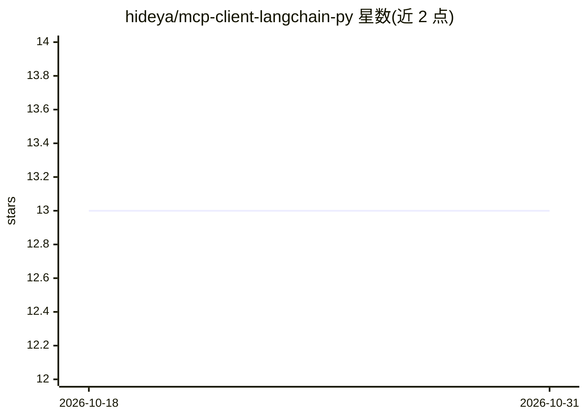

# hideya/mcp-client-langchain-py

⭐ 13 · Python · MIT · 推送 2026-08-23 · [GitHub](https://github.com/hideya/mcp-client-langchain-py) · 个人维护

**命令行 MCP 客户端：用 LangChain ReAct agent 测试与探索 MCP 服务器**

基于 LangChain Agent 与 langchain-mcp-tools 的文本 CLI 客户端，面向需要测试 MCP 服务器、探索其能力并原型化集成的开发者。通过 convert_mcp_to_langchain_tools() 将 MCP 工具转为 LangChain 工具，由 ReAct agent 调用；JSON5 配置文件定义 LLM 与 MCP 服务器（格式沿用 Claude for Desktop），支持 OpenAI/Anthropic/Google/xAI/Cerebras/Groq 多家 LLM 提供商。限制：工具调用仅支持文本结果，且仅实现 MCP Tools，不支持 Resources/Prompts/Sampling；基于的 MCP 协议版本为 2025-03-26。

## 筛选速览

| 维度 | 判定 | 备注 |
|---|---|---|
| AI 角色 | `ai-ecosystem` | LLM/agent 周边工具 |
| 许可风险 | `permissive` | MIT |
| 部署形态 | `library` | 以包/库形式分发 |
| 模型依赖 | locked-api |  |
| 硬件要求 | — | 无带数字的原话,不猜 |
| 安装摩擦 | `low` | 无编译、无系统依赖或容器化 |
| 成熟度 | — | 结构信号不足 |

## 能力要点

- convert_mcp_to_langchain_tools() 将 MCP 工具转为 LangChain 工具供 ReAct agent 调用
- 支持 OpenAI/Anthropic/Google/xAI/Cerebras/Groq 六家 LLM 提供商
- JSON5 配置支持环境变量替换（${...}）与本地/远程 MCP 服务器
- 本地 MCP 服务器日志保存与 --verbose 详细日志

## 适用场景

- 命令行快速测试 MCP 服务器的工具是否可用
- 在接入正式应用前原型化 MCP 集成方案
- 对比不同 LLM 提供商驱动同一 MCP 服务器的效果

## 场景标签

`Agent 框架` · 领域:Agent 开发

## 证据(README 行号)

> L15: A simple, text-based CLI client for Model Context Protocol (MCP) servers built with LangChain and Python.
> L16: Suitable for testing MCP servers, exploring their capabilities, and prototyping integrations.
> L18: Internally it uses LangChain Agent and

## 星数曲线

2026-10-18 13 → 2026-10-31 13（+0）

---
*卡片 v1 · prompt 1.4 · 生成 2026-10-31 · 置信度 high · 依据 README sha `e634f34d56c6` · [字段定义](../../DATASET.md)*
