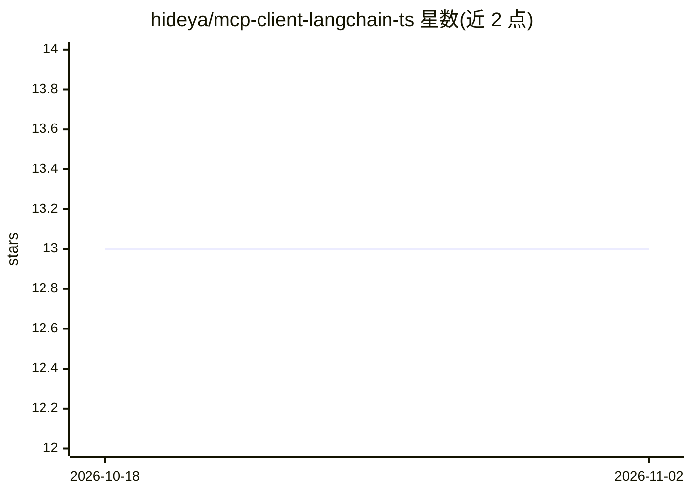

# hideya/mcp-client-langchain-ts

⭐ 13 · JavaScript · MIT · 推送 2026-08-23 · [GitHub](https://github.com/hideya/mcp-client-langchain-ts) · 个人维护

**命令行 MCP 客户端：用 LangChain ReAct 测试探索 MCP 服务器**

基于 LangChain 与 TypeScript 的文本 CLI 客户端，用于从命令行测试和探索 MCP（Model Context Protocol）服务器。内置 convertMcpToLangchainTools() 将 MCP 工具转换为 LangChain 工具，并自动调整工具 schema 以提升 LLM 兼容性；支持 OpenAI、Anthropic、Google、xAI、Cerebras、Groq 多家 LLM 提供商，通过 JSON5 配置文件与 .env 管理凭据。限制：仅支持工具调用的文本结果，未实现 MCP Resources/Prompts/Sampling；不支持 MCP 2026-07-28 规范。

## 筛选速览

| 维度 | 判定 | 备注 |
|---|---|---|
| AI 角色 | `ai-ecosystem` | LLM/agent 周边工具 |
| 许可风险 | `permissive` | MIT |
| 部署形态 | `library` | 以包/库形式分发 |
| 模型依赖 | locked-api |  |
| 硬件要求 | — | 无带数字的原话,不猜 |
| 安装摩擦 | `low` | 无编译、无系统依赖或容器化 |
| 成熟度 | — | 结构信号不足 |

## 能力要点

- 自动调整 MCP 工具 schema 以提升 LLM 兼容性
- 支持 OpenAI/Anthropic/Google/xAI/Cerebras/Groq 六类 LLM 提供商
- JSON5 配置（兼容 Claude for Desktop 的 mcpServers 结构）支持环境变量替换
- 支持本地（stdio）与远程（OAuth）MCP 服务器连接

## 适用场景

- 开发时快速测试 MCP 服务器是否正常工作
- 探索某个 MCP 服务器提供了哪些工具能力
- 在接入真实应用前原型验证 LLM 与 MCP 工具的集成

## 场景标签

`Agent 框架` · 领域:Agent 开发

## 证据(README 行号)

> L15: A simple, text-based CLI client for Model Context Protocol (MCP) servers built with LangChain and TypeScript.
> L17: Suitable for testing MCP servers, exploring their capabilities, and prototyping integrations.

## 星数曲线

2026-10-18 13 → 2026-11-02 13（+0）

---
*卡片 v1 · prompt 1.4 · 生成 2026-10-31 · 置信度 high · 依据 README sha `62f5cb69a3f3` · [字段定义](../../DATASET.md)*
