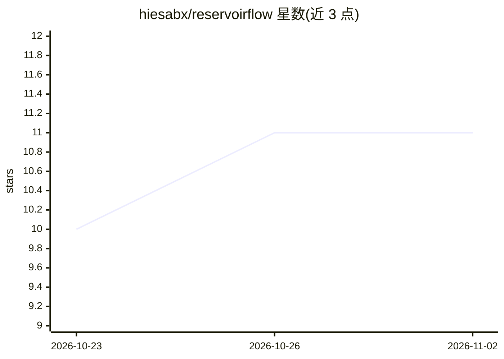

# hiesabx/reservoirflow

⭐ 11 · Python · NOASSERTION · 推送 2026-10-23 · [GitHub](https://github.com/hiesabx/reservoirflow) · [官网](http://reservoirflow.hiesab.com) · 组织维护

**油藏模拟与工程的 Python 库，支持物理信息神经网络求解**

由 Hiesab 开发的开源 Python 库，用于研究多孔介质流体流动，覆盖地下储能系统与油藏模拟工程。关键机制：可对同一问题比较和组合解析解、数值解与神经网络解（PINNs），计划支持 NumPy/SciPy/JAX/PyTorch/TensorFlow 等后端及 GPU/TPU 高性能计算。当前处于 Beta 状态（v0.1.0b1，2025-05-01 发布），多数模块未完全实现；采用 CC BY-NC-SA 4.0 许可，商用需另行授权。面向学生、高校、研究人员与工程师。

## 筛选速览

| 维度 | 判定 | 备注 |
|---|---|---|
| AI 角色 | `ai-native` | 本体是模型或模型工具 |
| 许可风险 | `none` | NOASSERTION |
| 部署形态 | `library` | 以包/库形式分发 |
| 模型依赖 | — | README 未给出锁定关系 |
| 硬件要求 | — | 无带数字的原话,不猜 |
| 安装摩擦 | `low` | 无编译、无系统依赖或容器化 |
| 成熟度 | `idea` | |

## 能力要点

- 比较/组合解析解、数值解与神经网络解（PINNs）
- 计划支持 NumPy/SciPy/JAX/PyTorch/TensorFlow 多后端
- pip 安装，推荐 Python 3.11
- 规划覆盖 CCS、PTA/RTA、EOR、PVT/EOS 等方向

## 适用场景

- 教学与科研中模拟多孔介质单相/多相流动
- 用 PINNs 求解并与数值解、解析解对照
- 学术论文方法的标准化实现与复现学习

## 场景标签

`科研工具` · 领域:学习与行业

## 证据(README 行号)

> L11: *ReservoirFlow* is a modern open-source Python library developed by Hiesab; see About Us. *ReservoirFlow* is design
> L13: *ReservoirFlow* is designed based on the modern Python stack for data science, scientific computing, machine learni

## 星数曲线

2026-10-23 10 → 2026-11-02 11（+1）

---
*卡片 v1 · prompt 1.4 · 生成 2026-11-02 · 置信度 high · 依据 README sha `237ae8d8dce0` · [字段定义](../../DATASET.md)*
