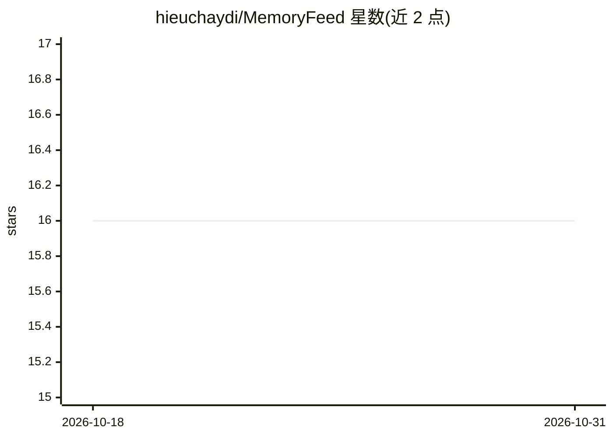

# hieuchaydi/MemoryFeed

⭐ 16 · Python · 推送 2026-05-13 · [GitHub](https://github.com/hieuchaydi/MemoryFeed) · [官网](https://docs-research-pv3h.vercel.app/) · 个人维护

**本地优先的社交记忆采集与混合检索系统**

由浏览器扩展（Chrome/Firefox）在用户停留 3 秒后采集社交帖子，FastAPI 后端存入 SQLite(WAL)+FTS5，LanceDB 存语义向量做多语言搜索；React 前端提供 Search/Active Feed/Timeline/Stats 操作台，Active Feed 按个人热度、衰减与重浮现间隔排序。可选 Gemini 视觉描述、Groq(Qwen) 文本改写摘要、pybind11 C++ 加速；默认本地优先，OFFLINE_ONLY=1 时不调用任何云端 AI。提供 MCP 模式向 agent 客户端输出带引用的受限检索上下文。

## 筛选速览

| 维度 | 判定 | 备注 |
|---|---|---|
| AI 角色 | `ai-enhanced` | 去掉 AI 部分产品仍成立 |
| 许可风险 | `none` | — |
| 部署形态 | `desktop` | 安装包/桌面程序 |
| 模型依赖 | locked-api |  |
| 硬件要求 | — | 无带数字的原话,不猜 |
| 安装摩擦 | `low` | 无编译、无系统依赖或容器化 |
| 成熟度 | — | 结构信号不足 |

## 能力要点

- 浏览器扩展按 3 秒停留阈值采集社交帖子，数据默认本地存储
- FTS5 全文 + LanceDB 语义向量的混合检索，支持多语言
- 离线纯本地模式无需任何云端 API key
- MCP 模式提供 build_memory_context 工具（带引用与截断可追溯）

## 适用场景

- 记录并日后检索我在社交平台上浏览过的帖子
- 在严格隐私要求下做纯本地的记忆管理与搜索
- 把个人记忆库作为 RAG 上下文接入 MCP agent 客户端

## 场景标签

`RAG` `语义搜索` `知识库管理` · 领域:知识与检索

## 证据(README 行号)

> L17: - Browser extension captures social posts after 3s dwell.
> L18: - FastAPI backend stores content in SQLite (WAL) + FTS5.
> L19: - LanceDB stores semantic vectors for multilingual search.
> L28: Local-first by default. Captured data is stored locally. Optional cloud AI providers may process selected text/imag

## 星数曲线

2026-10-18 16 → 2026-10-31 16（+0）

---
*卡片 v1 · prompt 1.4 · 生成 2026-10-30 · 置信度 mid · 依据 README sha `52d0cc199e9b` · [字段定义](../../DATASET.md)*
