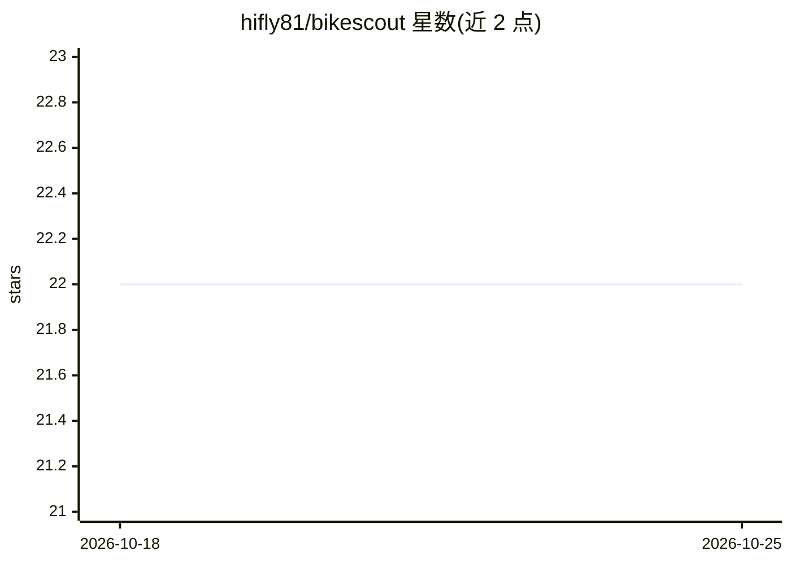

# hifly81/bikescout

⭐ 22 · Python · AGPL-3.0 · 推送 2026-09-26 · [GitHub](https://github.com/hifly81/bikescout) · [官网](https://hifly81.github.io/bikescout/) · 个人维护

**面向骑行者的 MCP 骑行路线规划与地形分析工具服务**

为 MTB、公路、砾石与电助力骑行提供路线规划的 AI 引擎：作为 MCP 工具服务接入 Claude Desktop、Cursor、Codex 等 Agent 客户端，也提供自带 GUI。读取 OpenStreetMap/OpenRouteService 地图数据与 Open-Meteo 天气预报，生成含泥泞风险预测（TAEL 泥浆模型）、S-Scale 地形分级、海拔剖面与胎压建议的路线情报。以 Python 编写，AGPLv3 许可，README 未给出具体安装命令。

## 筛选速览

| 维度 | 判定 | 备注 |
|---|---|---|
| AI 角色 | `ai-ecosystem` | LLM/agent 周边工具 |
| 许可风险 | `viral` | AGPL-3.0 |
| 部署形态 | `None` |  |
| 模型依赖 | — | README 未给出锁定关系 |
| 硬件要求 | — | 无带数字的原话,不猜 |
| 安装摩擦 | `low` | 无编译、无系统依赖或容器化 |
| 成熟度 | — | 结构信号不足 |

## 能力要点

- 以 MCP 工具服务形式接入多种 Agent 客户端，另提供 GUI
- 泥泞风险预测与 S-Scale 地形分级
- 聚合 OpenRouteService/OpenStreetMap/Open-Meteo 开放数据
- 输出装备建议、胎压计算与安全检查清单

## 适用场景

- 通过对话式 Agent 规划适配车型与天气的骑行路线
- 出发前评估路线的泥泞风险与技术难度
- 赛后结合地形数据复盘配速表现

## 场景标签

 · 领域:运动/地理空间导航

## 证据(README 行号)

> L17: - instruction, using the **BikeScout GUI**
> L18: - instruction, using your favourite MCP Agent client: Claude Desktop, Cursor, Codex, Google Antigravity, Windsurf

## 星数曲线

2026-10-18 22 → 2026-10-25 22（+0）

---
*卡片 v1 · prompt 1.4 · 生成 2026-10-18 · 置信度 mid · 依据 README sha `fad41c3469c4` · [字段定义](../../DATASET.md)*
