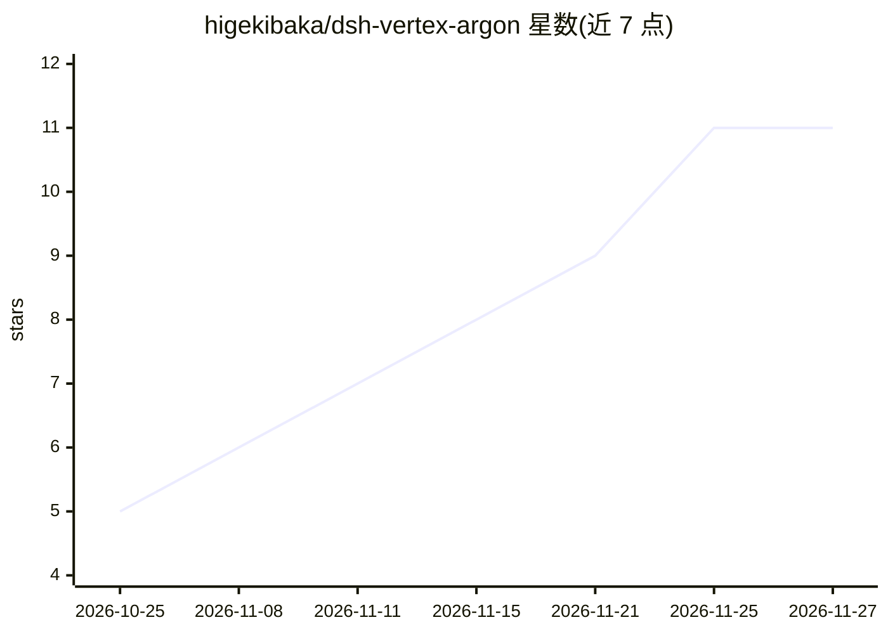

# higekibaka/dsh-vertex-argon

⭐ 11 · JavaScript · MIT · 推送 2026-11-24 · [GitHub](https://github.com/higekibaka/dsh-vertex-argon) · [官网](https://www.npmjs.com/package/dsh-vertex-argon) · 个人维护 · 中文 README

**DSH 的 Gemini 4 双通道适配插件：接入 Vertex AI 与 Gemini API**

面向 DeepSeek Harness（DSH）宿主的插件，通过 Google 官方双通道接入 Vertex AI 与 Gemini Developer API，暴露 gemini-4 argon/carbon/hydrogen/neon 共 8 个模型路由。支持 GenerateContent 与 Interactions 双协议、Low/Medium/High（Hydrogen/Neon 含 xhigh）思考档位映射、thoughtSignature 签名回放与跨模型切换时的历史降级清洗，并提供 65K+ 多跳长解码续传与诊断面板。运行要求 DSH >=0.2.0-rc.2 与 Node.js ^22.19.0 || >=24.0.0，需自备 Google 官方凭据。

## 筛选速览

| 维度 | 判定 | 备注 |
|---|---|---|
| AI 角色 | `ai-ecosystem` | LLM/agent 周边工具 |
| 许可风险 | `permissive` | MIT |
| 部署形态 | `None` |  |
| 模型依赖 | — | README 未给出锁定关系 |
| 硬件要求 | — | 无带数字的原话,不猜 |
| 安装摩擦 | `low` | 无编译、无系统依赖或容器化 |
| 成熟度 | — | 结构信号不足 |

## 能力要点

- Vertex AI 与 Gemini Developer API 双官方通道、8 模型路由，凭据与网关隔离
- 原生思考档位映射与 thoughtSignature 签名回放、跨模型切换历史清洗
- 65K+ 多跳长解码：检查点续传、四阶段超时看门狗、仅思考自愈
- 诊断面板与只读智能体工具 argon_inspect，可查逐跳轨迹与云端 Interaction ID

## 适用场景

- 在 DSH 中通过官方通道使用 Gemini 4 系列模型
- 单回合生成超 65K tokens 的长输出并断流续传
- 排查模型请求逐跳耗时、Token 水位与失败原因

## 场景标签

`模型网关` · 领域:Agent 开发

## 证据(README 行号)

> L5: **面向 DeepSeek Harness 的 Google 官方双通道（Vertex AI + Gemini Developer API）Gemini 4 适配器，原生支持 Argon、Carbon、Hydrogen 与 Neon
> L15: - **双官方通道 × 八模型路由**：同时接入 Google Cloud **Vertex AI**（`gemini-4-argon` / `gemini-4-carbon` / `gemini-4-hydrogen` / `g
> L9: - **运行要求**：DSH `>=0.2.0-rc.2`，Node.js `^22.19.0 || >=24.0.0`（见 package.json）

## 星数曲线

2026-10-25 5 → 2026-11-27 11（+6）

---
*卡片 v1 · prompt 1.4 · 生成 2026-11-20 · 置信度 high · 依据 README sha `a7ef798643ca` · [字段定义](../../DATASET.md)*
