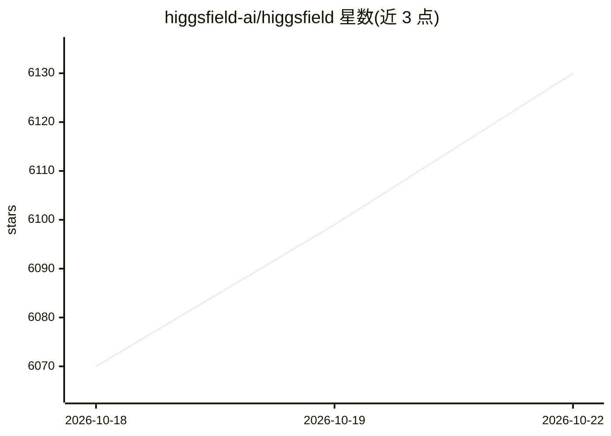

# higgsfield-ai/higgsfield

⭐ 6,140 · Jupyter Notebook · Apache-2.0 · 推送 2026-10-07 · [GitHub](https://github.com/higgsfield-ai/higgsfield) · 组织维护

**面向十亿至万亿参数模型训练的容错 GPU 编排与训练框架**

开源 GPU 工作负载管理器与机器学习训练框架，用于训练十亿到万亿参数的大模型。核心功能包括节点资源独占/非独占分配、支持 ZeRO-3 DeepSpeed API 与 PyTorch FSDP 分片、实验的发起/执行/监控、实验队列管理以及与 GitHub/GitHub Actions 的持续集成。节点要求 Ubuntu、SSH 访问与无密码 sudo 的非 root 用户；在 Azure、LambdaLabs、FluidStack 云上测试过。通过 pip 安装，需节点上安装 Docker。

## 筛选速览

| 维度 | 判定 | 备注 |
|---|---|---|
| AI 角色 | `ai-ecosystem` | LLM/agent 周边工具 |
| 许可风险 | `permissive` | Apache-2.0 |
| 部署形态 | `library` | 以包/库形式分发 |
| 模型依赖 | — | README 未给出锁定关系 |
| 硬件要求 | — | 无带数字的原话,不猜 |
| 安装摩擦 | `medium` | 含编译或系统依赖之一 |
| 成熟度 | — | 结构信号不足 |

## 能力要点

- 支持 ZeRO-3 DeepSpeed API 与 PyTorch FSDP 分片训练万亿参数模型
- 节点资源分配与实验队列管理
- 经 GitHub/GitHub Actions 自动部署代码并访问实验运行 UI
- 兼容 deepspeed、accelerate 及自定义 pytorch sharding 工作流

## 适用场景

- 多节点分布式训练 LLaMA 等大语言模型
- 团队内按队列调度与监控 GPU 实验资源
- 通过 GitHub Actions 自动部署与运行训练实验

## 场景标签

`MLOps` `模型训练` · 领域:训练与推理

## 证据(README 行号)

> L3: Higgsfield is an open-source, fault-tolerant, highly scalable GPU orchestration, and a machine learning framework de
> L9: Higgsfield serves as a GPU workload manager and machine learning framework with five primary functions:

## 星数曲线

2026-10-18 6,070 → 2026-10-22 6,130（+60）

---
*卡片 v1 · prompt 1.4 · 生成 2026-10-20 · 置信度 high · 依据 README sha `a48a87aea5a1` · [字段定义](../../DATASET.md)*
