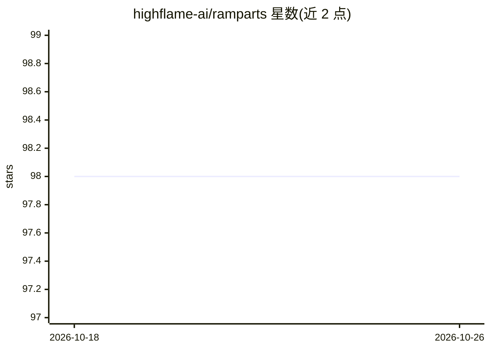

# highflame-ai/ramparts

⭐ 98 · Rust · Apache-2.0 · 推送 2026-10-08 · [GitHub](https://github.com/highflame-ai/ramparts) · [官网](https://www.highflame.com) · 组织维护

**MCP 服务器与 AI agent 技能文件的安全扫描器**

用 Rust 编写的命令行安全扫描工具，扫描两类 AI agent 信任面：MCP 服务器（通过 HTTP/SSE/stdio/subprocess 多传输发现 tools/resources/prompts 并审计提示注入、工具投毒、命令注入、供应链 CVE 等）与磁盘上的技能文件（Claude Code 命令、agentskills.io bundle、Cursor/Codex/Windsurf/Gemini 变体）。检测管线包含 40 条 YARA 规则（含对抗编码/零宽字符的归一化重扫）、LLM 语义分析、OWASP MCP Top 10 与 Agentic Skills Top 10 标注、指纹漂移检测，输出 terminal/JSON/SARIF/markdown 报告，可 `ramparts mcp-stdio` 作为 MCP 服务器运行。README 自述仍在积极开发中，静态分析需与运行时防护结合。

## 筛选速览

| 维度 | 判定 | 备注 |
|---|---|---|
| AI 角色 | `ai-ecosystem` | LLM/agent 周边工具 |
| 许可风险 | `permissive` | Apache-2.0 |
| 部署形态 | `self-host` | docker 或自建部署 |
| 模型依赖 | — | README 未给出锁定关系 |
| 硬件要求 | — | 无带数字的原话,不猜 |
| 安装摩擦 | `low` | 无编译、无系统依赖或容器化 |
| 成熟度 | `idea` | |

## 能力要点

- MCP 服务器多传输扫描与技能文件扫描共用同一安全管线
- 40 条 YARA 规则 + 归一化/编码解码视图的抗规避重扫
- OWASP MCP Top 10 与 Agentic Skills Top 10 (AST01-AST10) 分类标注
- SARIF 2.1.0 输出可接入 GitHub/GitLab/Azure DevOps 代码扫描

## 适用场景

- 接入第三方 MCP 服务器前先做安全审计
- 发布 agentskills.io 技能包前验证规范并检查过宽工具授权
- 在 CI/CD 中对新增技能或 MCP 配置变更的 PR 设卡
- 满足 AI agent 部署的合规审计证据要求

## 场景标签

`网络安全` · 领域:学习与行业

## 证据(README 行号)

> L17: **Ramparts** scans the two surfaces an AI agent trusts most: the **MCP servers** it talks to over the network, and 
> L30: Ramparts provides **security scanning** of the MCP-and-skill ecosystem by:
> L36: 5. **LLM-powered analysis** — sophisticated semantic issues no static rule can spot (tool descriptions that lie abo

## 星数曲线

2026-10-18 98 → 2026-10-26 98（+0）

---
*卡片 v1 · prompt 1.4 · 生成 2026-10-23 · 置信度 mid · 依据 README sha `33331182aa38` · [字段定义](../../DATASET.md)*
