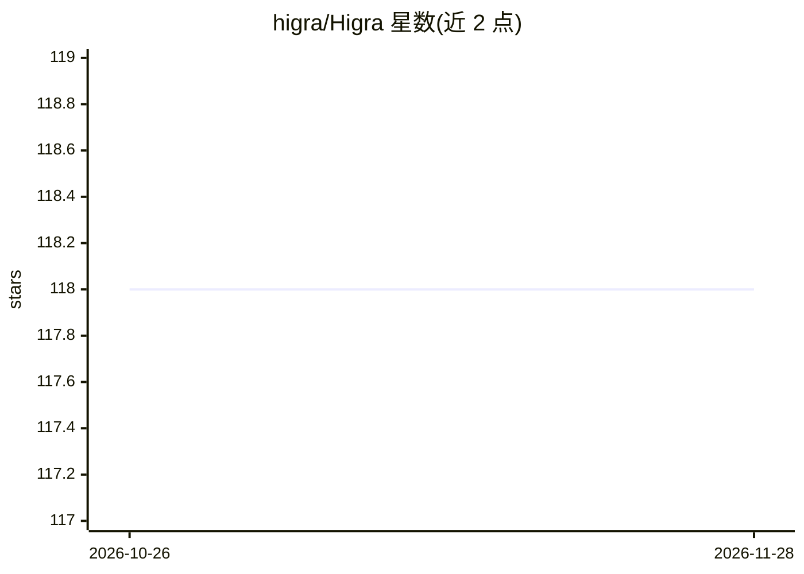

# higra/Higra

⭐ 118 · C++ · NOASSERTION · 推送 2026-11-27 · [GitHub](https://github.com/higra/Higra) · [官网](https://higra.readthedocs.io/) · 组织维护

**面向稀疏图与层次化聚类分析的 C++/Python 库**

Higra 提供 C++/Python 双接口，专注稀疏图分析与层次化方法：支持树状图与显著性图的双重表示、多种层次聚类构建（quasi-flat zone、层次分水岭、单/平均/完全/Ward 等链接规则）、分量树、层次上的优化（最优割、能量层次）、聚类评估及面向图像分析的网格图工具箱。数据结构与数据解耦，Python 端使用 numpy 数组。通过 PyPI 安装，支持 Python 3.10-3.14 与三大平台，附演示 notebook 仓库与文档站。

## 筛选速览

| 维度 | 判定 | 备注 |
|---|---|---|
| AI 角色 | `ai-native` | 本体是模型或模型工具 |
| 许可风险 | `none` | NOASSERTION |
| 部署形态 | `library` | 以包/库形式分发 |
| 模型依赖 | — | README 未给出锁定关系 |
| 硬件要求 | — | 无带数字的原话,不猜 |
| 安装摩擦 | `low` | 无编译、无系统依赖或容器化 |
| 成熟度 | — | 结构信号不足 |

## 能力要点

- 层次聚类方法覆盖多种链接规则与约束连接性层次
- 树（树状图）与显著性图双重表示的数据结构与操作
- 层次上的优化：最优割与能量层次
- 图像工具箱：树形结构、Mumford-Shah 能量优化

## 适用场景

- 对图数据做层次化聚类与簇提取
- 图像分割与基于层次聚类的图像过滤
- 对图聚类结果做有监督评估
- 在 C++ 中基于 Higra 生成带 Python 绑定的扩展

## 场景标签

 · 领域:机器学习/图分析

## 证据(README 行号)

> L7: Higra is a C++/Python library for efficient sparse graph analysis with a special focus on hierarchical methods. Some
> L10: - hierarchical clusterings: quasi-flat zone hierarchy, hierarchical watersheds, agglomerative clustering (single-li

## 星数曲线

2026-10-26 118 → 2026-11-28 118（+0）

---
*卡片 v1 · prompt 1.4 · 生成 2026-11-28 · 置信度 high · 依据 README sha `ff1bd7bc8cd3` · [字段定义](../../DATASET.md)*
