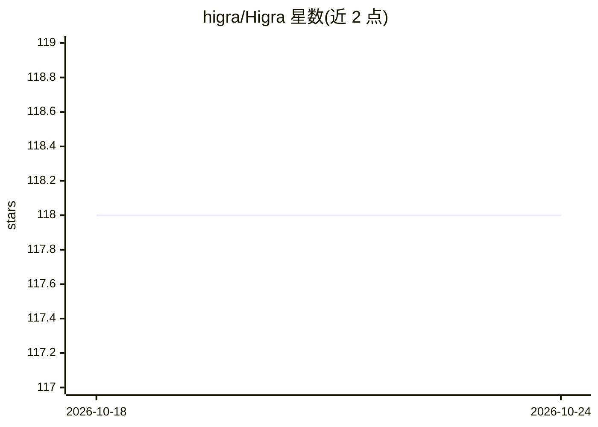

# higra/Higra

⭐ 118 · C++ · NOASSERTION · 推送 2026-10-23 · [GitHub](https://github.com/higra/Higra) · [官网](https://higra.readthedocs.io/) · 组织维护

**C++/Python 层次图分析库：高效层次聚类与图像分析**

面向稀疏图分析的 C++/Python 库，核心围绕层次化方法：树（树状图）与显著性图双表示、多种凝聚聚类（单/平均/完全连接、Ward 等）、分量树、层级操作与属性计算、层级优化切割、图算法及监督式聚类评估，并提供面向网格图、形状树与 Mumford-Shah 能量优化的图像工具箱。数据结构与数据解耦，权重直接用 numpy/xtensor 数组。pip 安装，支持 Linux/macOS/Windows 64 位与 Python 3.10-3.14。

## 筛选速览

| 维度 | 判定 | 备注 |
|---|---|---|
| AI 角色 | `ai-native` | 本体是模型或模型工具 |
| 许可风险 | `none` | NOASSERTION |
| 部署形态 | `library` | 以包/库形式分发 |
| 模型依赖 | — | README 未给出锁定关系 |
| 硬件要求 | — | 无带数字的原话,不猜 |
| 安装摩擦 | `low` | 无编译、无系统依赖或容器化 |
| 成熟度 | — | 结构信号不足 |

## 能力要点

- 层次聚类双表示（树与显著性图）的高效处理
- 凝聚聚类支持多种连接规则及用户自定义
- 面向图像分析的专用工具箱（形状树、Mumford-Shah 能量优化）
- 图聚类与层次聚类的监督式评估

## 适用场景

- 对图像做层次聚类分割与滤波
- 实现层次分水岭、分量树等图分析算法
- 评估图聚类结果的质量

## 场景标签

`目标检测` · 领域:感知与多模态

## 证据(README 行号)

> L7: Higra is a C++/Python library for efficient sparse graph analysis with a special focus on hierarchical methods. Some
> L10: - hierarchical clusterings: quasi-flat zone hierarchy, hierarchical watersheds, agglomerative clustering (single-li
> L16: - image toolbox: special methods for grid graphs, tree of shapes, hierarchical clustering methods dedicated to imag

## 星数曲线

2026-10-18 118 → 2026-10-24 118（+0）

---
*卡片 v1 · prompt 1.4 · 生成 2026-10-23 · 置信度 high · 依据 README sha `bc10bb2595b2` · [字段定义](../../DATASET.md)*
