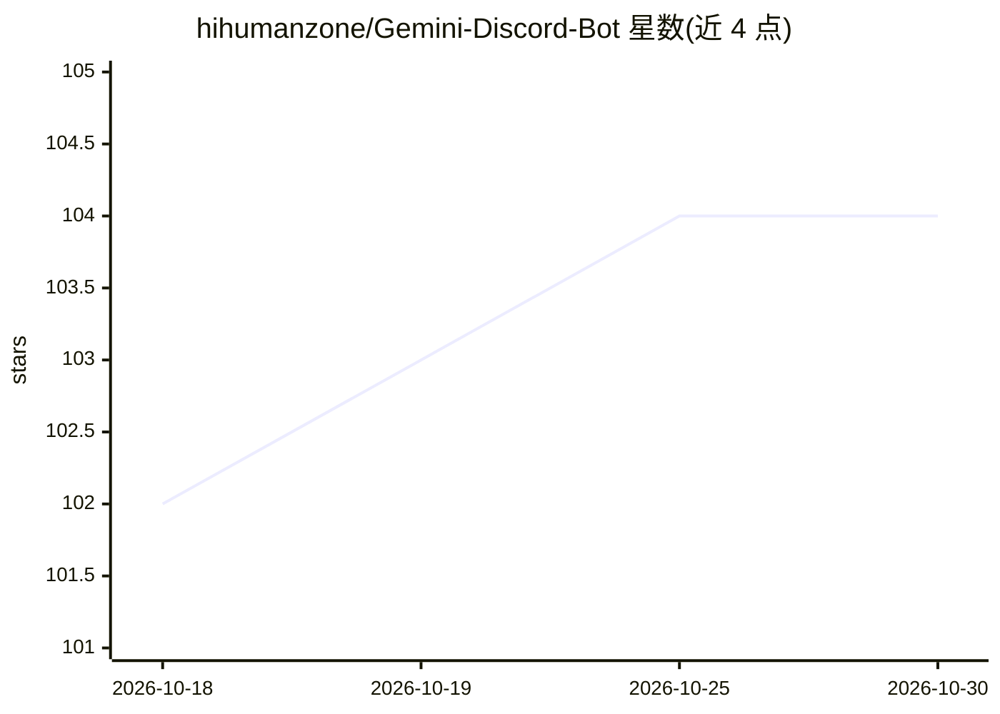

# hihumanzone/Gemini-Discord-Bot

⭐ 104 · JavaScript · MIT · 推送 2026-09-14 · [GitHub](https://github.com/hihumanzone/Gemini-Discord-Bot) · 个人维护

**基于 Google Gemini 的多模态 AI Discord 机器人**

用 Node.js 和 Discord.js 构建的 Discord 机器人，通过 Gemini API 提供流式回复。支持文本、图片、视频、音频、PDF 及办公/代码文件的多模态输入，具备按用户会话记忆与频道/服务器级共享记忆，可切换 Google Search、URL Context、Code Execution 等 Gemini 工具。包含 Nano Banana 模式（gemini-2.5-flash-image）用于图像生成与编辑，提供管理员管控、斜杠命令与设置界面。需 Node.js 20+、Discord bot token 与 Gemini API key，经 git clone 与 npm install 安装，状态以本地 JSON 持久化。

## 筛选速览

| 维度 | 判定 | 备注 |
|---|---|---|
| AI 角色 | `ai-native` | 本体是模型或模型工具 |
| 许可风险 | `permissive` | MIT |
| 部署形态 | `library` | 以包/库形式分发 |
| 模型依赖 | — | README 未给出锁定关系 |
| 硬件要求 | — | 无带数字的原话,不猜 |
| 安装摩擦 | `low` | 无编译、无系统依赖或容器化 |
| 成熟度 | — | 结构信号不足 |

## 能力要点

- 多模态输入：文本/图片/视频/音频/PDF/办公与代码文件
- 会话记忆：按用户多会话，可选频道或服务器级共享记忆
- 可切换 Gemini 工具：Google Search、URL Context、Code Execution
- Nano Banana 模式（gemini-2.5-flash-image）图像生成与编辑

## 适用场景

- 在 Discord 服务器或私信中与 Gemini 对话
- 让 bot 理解并回应图片、视频、音频与文档内容
- 管理员配置服务器/频道级行为并管理用户封锁

## 场景标签

`聊天机器人` `多模态` `图像生成` · 领域:对话与助手

## 证据(README 行号)

> L8: AI Discord bot powered by Google Gemini with streaming responses, multimodal input, session-based memory, and rich s
> L15: - Understands text, images, videos, audio, PDFs, and office/code files

## 星数曲线

2026-10-18 102 → 2026-10-30 104（+2）

---
*卡片 v1 · prompt 1.4 · 生成 2026-10-23 · 置信度 high · 依据 README sha `78829929b637` · [字段定义](../../DATASET.md)*
