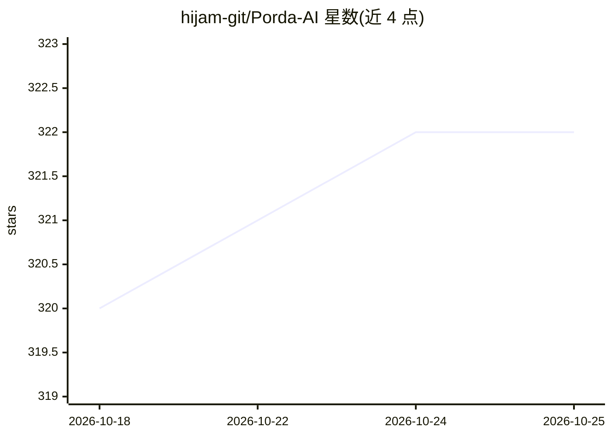

# hijam-git/Porda-AI

⭐ 322 · Python · AGPL-3.0 · 推送 2026-10-20 · [GitHub](https://github.com/hijam-git/Porda-AI) · [官网](https://pordaai.com/) · 个人维护

**面向穆斯林用户的实时屏幕遮挡工具：AI 检测并模糊不当内容**

Windows 桌面应用，用自定义训练的检测模型实时截取屏幕窗口，识别 NSFW/Non-Mahram 对象并在屏幕上以模糊、纯色块等方式覆盖，适用于浏览器、视频播放器等任意场景。全程离线运行，不外传数据。支持 Intel OpenCL GPU 加速、按应用启停检测、快捷键开关、自动睡眠与高 CPU 时自动停用。仅兼容 Windows 10/11（Linux 可经 Bottle 测试）；GPU 支持限于 Intel OpenCL，CUDA 为未来计划。提供安装包下载，也可从源码以 pip 依赖加 python main.py 运行，或用 PyInstaller 打包。

## 筛选速览

| 维度 | 判定 | 备注 |
|---|---|---|
| AI 角色 | `ai-native` | 本体是模型或模型工具 |
| 许可风险 | `viral` | AGPL-3.0 |
| 部署形态 | `desktop` | 安装包/桌面程序 |
| 模型依赖 | — | README 未给出锁定关系 |
| 硬件要求 | — | 无带数字的原话,不猜 |
| 安装摩擦 | `medium` | 含编译或系统依赖之一 |
| 成熟度 | `idea` | |

## 能力要点

- 自定义训练模型的实时屏幕对象检测与覆盖（模糊/纯色/背景色）
- 全程离线运行，不发送或存储外部数据
- 按应用启停检测、系统托盘、开机自启、高 CPU 自动停用
- Intel GPU（OpenCL）硬件加速支持

## 适用场景

- 浏览网页或看视频时自动模糊不当图像内容
- 线上会议中出现不符合宗教规范画面时自动遮挡
- 按应用粒度自定义检测范围

## 场景标签

`目标检测` · 领域:感知与多模态

## 证据(README 行号)

> L51: - Captures data (screenshots) from the window.
> L52: - Detects objects within the captured data by our custome model.
> L53: - Generates an overlay box or applies blur directly onto the screen transperantly.

## 星数曲线

2026-10-18 320 → 2026-10-25 322（+2）

---
*卡片 v1 · prompt 1.4 · 生成 2026-10-21 · 置信度 mid · 依据 README sha `fac7290fa509` · [字段定义](../../DATASET.md)*
