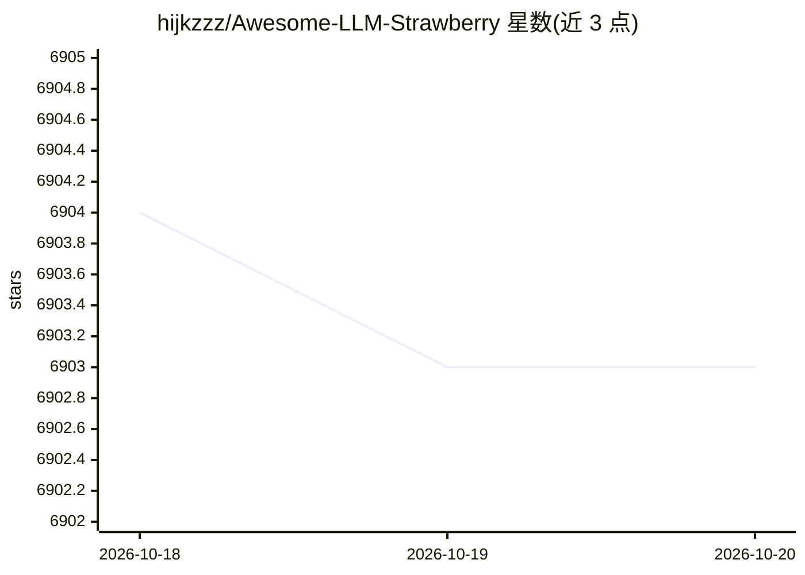

# hijkzzz/Awesome-LLM-Strawberry

⭐ 6,903 · Apache-2.0 · 推送 2025-12-17 · [GitHub](https://github.com/hijkzzz/Awesome-LLM-Strawberry) · 个人维护 · 中文 README

**LLM 推理研究论文/博客/开源项目策展清单（聚焦 OpenAI o1）**

持续更新的 LLM 推理（Reasoning）资料聚合仓库：收录围绕 OpenAI o1/Strawberry 的新闻、博客、演讲、课程、开源模型与训练代码库，以及按年份组织的论文条目（含作者、发布方与代码链接），主题覆盖强化学习、链式思维、数学推理、MCTS 与视觉推理等。条目以链接列表形式组织，无安装或运行组件，供研究人员跟踪 LLM 推理前沿进展。

## 筛选速览

| 维度 | 判定 | 备注 |
|---|---|---|
| AI 角色 | `ai-knowledge` | 知识聚合/清单类 |
| 许可风险 | `permissive` | Apache-2.0 |
| 部署形态 | `None` |  |
| 模型依赖 | — | README 未给出锁定关系 |
| 硬件要求 | — | 无带数字的原话,不猜 |
| 安装摩擦 | `low` | 无编译、无系统依赖或容器化 |
| 成熟度 | — | 结构信号不足 |

## 能力要点

- 覆盖新闻/博客/演讲/课程/论文的多类别资料聚合
- 收录开源推理模型与 RL 训练代码库（OpenRLHF、SimpleRL、EasyR1 等）
- 按年份组织论文条目并附作者、发布方与代码链接
- 围绕 OpenAI o1 与推理技术专题持续更新

## 适用场景

- 查找 LLM 推理方向的代表性论文与技术报告
- 了解 o1 复现与 RL 训练相关的开源模型和代码库
- 跟踪推理模型的最新进展动态

## 场景标签

`精选清单` · 领域:学习与行业

## 证据(README 行号)

> L4: This is a collection of research papers & blogs for **OpenAI Strawberry(o1) and Reasoning**.
> L6: And the repository will be continuously updated to track the frontier of LLM Reasoning.

## 星数曲线

2026-10-18 6,904 → 2026-10-20 6,903（-1）

---
*卡片 v1 · prompt 1.4 · 生成 2026-10-20 · 置信度 high · 依据 README sha `e669727aedaf` · [字段定义](../../DATASET.md)*
