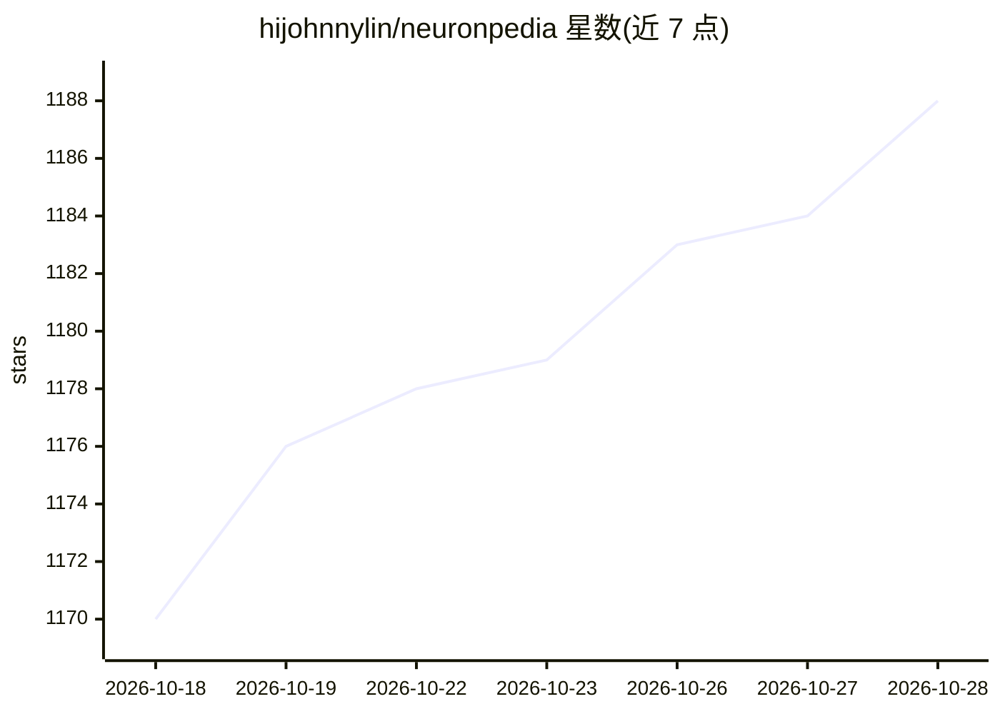

# hijohnnylin/neuronpedia

⭐ 1,192 · TypeScript · Apache-2.0 · 推送 2026-10-27 · [GitHub](https://github.com/hijohnnylin/neuronpedia) · [官网](https://neuronpedia.org) · 组织维护

**面向机制可解释性研究的开源平台：SAE 特征浏览、激活测试与归因图**

Neuronpedia 是开源的可解释性（interpretability）平台，提供 SAE 特征看板、激活测试、steering、自动解释（autointerp，基于 EleutherAI 的 Delphi 生成解释与评分）、归因图（基于 circuit-tracer）等功能，面向可解释性研究者与开发者。本地部署由多个服务组成：webapp（前端+API，Node.js）、inference（vLLM/eager PyTorch 后端）、graph 与 autointerp 服务，数据存于 Postgres 16+ 并用 pgvector 做语义搜索。限制：本地数据库初始为空需自行导入数据；autointerp 的 embedding 评分器仅支持 CUDA。

## 筛选速览

| 维度 | 判定 | 备注 |
|---|---|---|
| AI 角色 | `ai-ecosystem` | LLM/agent 周边工具 |
| 许可风险 | `permissive` | Apache-2.0 |
| 部署形态 | `library` | 以包/库形式分发 |
| 模型依赖 | local-ok | 支持本地模型 |
| 硬件要求 | — | 无带数字的原话,不猜 |
| 安装摩擦 | `high` | 编译与系统依赖俱全 |
| 成熟度 | — | 结构信号不足 |

## 能力要点

- SAE 特征看板、激活测试、steering、搜索与导出等功能
- 自动解释与评分服务（EleutherAI Delphi）
- 归因图生成服务（基于 circuit-tracer）
- 本地推理后端自动选择 vLLM（CUDA）或 eager PyTorch，模型权重复用 Hugging Face 缓存

## 适用场景

- 研究者在本地浏览与测试 SAE 特征及激活
- 对模型特征做自动解释与评分
- 生成与分析归因图（attribution graphs）
- 自建可解释性数据平台并导入自己的 sources/SAEs

## 场景标签

`科研工具` · 领域:学习与行业

## 证据(README 行号)

> L7:  Open source interpretability platform
> L9:  api · steering · activations · circuits/graphs · natural language autoencoders · jacobian lens · autointerp · scori
> L106: This subsection shows you how to run an inference instance locally so you can do things like steering, activation 

## 星数曲线

2026-10-18 1,170 → 2026-10-28 1,188（+18）

---
*卡片 v1 · prompt 1.4 · 生成 2026-10-21 · 置信度 mid · 依据 README sha `19c22b99dace` · [字段定义](../../DATASET.md)*
