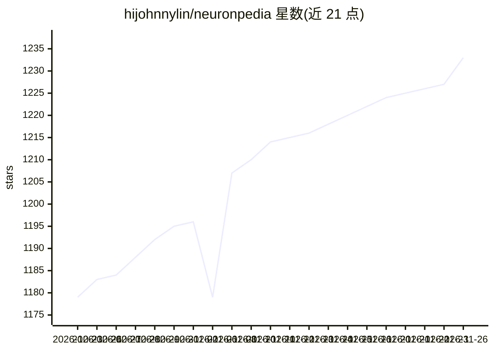

# hijohnnylin/neuronpedia

⭐ 1,233 · TypeScript · Apache-2.0 · 推送 2026-11-21 · [GitHub](https://github.com/hijohnnylin/neuronpedia) · [官网](https://neuronpedia.org) · 个人维护

**面向可解释性研究者的开源特征可视化与解释平台**

Neuronpedia 是开源的模型可解释性平台，提供特征搜索、激活查看、steering、归因图、自动解释与评分、导出与上传等功能。本地部署由多个服务组成：webapp（前端+API）、本地数据库、inference 推理服务、graph 图生成服务（基于 circuit-tracer）和 autointerp 自动解释服务（基于 EleutherAI 的 Delphi），各服务通过 make 命令启动并经 host-add 注册互通。数据需通过管理面板手动导入，数据库初始为空。

## 筛选速览

| 维度 | 判定 | 备注 |
|---|---|---|
| AI 角色 | `ai-native` | 本体是模型或模型工具 |
| 许可风险 | `permissive` | Apache-2.0 |
| 部署形态 | `library` | 以包/库形式分发 |
| 模型依赖 | local-ok | 支持本地模型 |
| 硬件要求 | — | 无带数字的原话,不猜 |
| 安装摩擦 | `high` | 编译与系统依赖俱全 |
| 成熟度 | — | 结构信号不足 |

## 能力要点

- 多服务架构：webapp、inference、graph、autointerp 各自独立运行并通过 OpenAPI 规范交互
- 本地推理支持按模型/SAE 源集配置，自动选择 vLLM(CUDA) 或 eager PyTorch 后端
- 提供多个预置推理配置（如 gpt2-small/res-jb），支持自定义 Hugging Face 模型加载
- 解释搜索基于 Postgres pgvector 扩展按语义匹配

## 适用场景

- 在本地查看和搜索模型特征的激活与解释
- 对已下载的模型/SAE 做 activation testing 与 steering
- 生成归因图并做特征的自动解释与评分

## 场景标签

`科研工具` `模型评测` · 领域:评测与运维

## 证据(README 行号)

> L7:  Open source interpretability platform
> L9:  api · steering · activations · circuits/graphs · natural language autoencoders · jacobian lens · autointerp · scori
> L212: The autointerp server provides automatic interpretation and scoring of neural network features. It uses EleutherAI

## 星数曲线

2026-10-23 1,179 → 2026-11-26 1,233（+54）

---
*卡片 v1 · prompt 1.4 · 生成 2026-11-23 · 置信度 mid · 依据 README sha `45ed5b72d3d8` · [字段定义](../../DATASET.md)*
