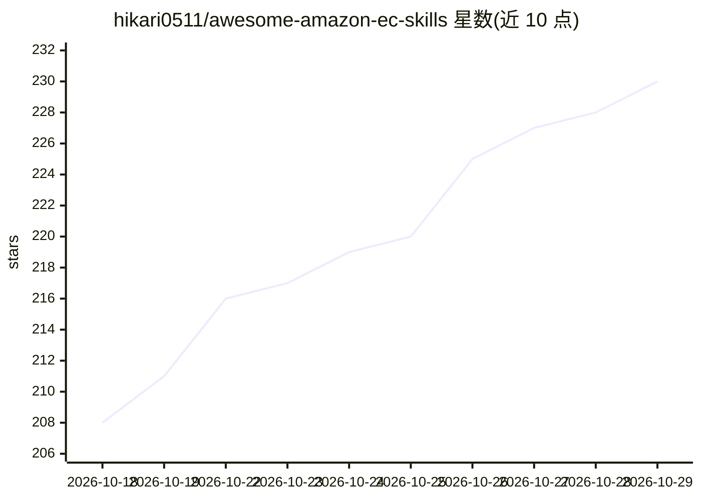

# hikari0511/awesome-amazon-ec-skills

⭐ 230 · CC0-1.0 · 推送 2026-05-19 · [GitHub](https://github.com/hikari0511/awesome-amazon-ec-skills) · 个人维护 · 中文 README

**亚马逊跨境电商场景的 Claude/AI Agent Skills 收录清单**

面向亚马逊跨境卖家的 AI Agent Skills 合集（awesome-list）：收录覆盖选品、竞品、Listing、视觉、数据 BI、广告、评论等环节及 1688 供货上游的 SKILL.md 格式技能与 MCP 服务，以 🆓/💎/💰 等 emoji 标注免费/付费等元信息。README 附带 Skill/Plugin/MCP/Subagent 概念对照、新手与进阶上手路径、SKILL.md 编写模板、5 步贡献流程与收录硬门槛（公开 repo、兼容 license、Amazon/1688 落点等）。仓库声明刚起步、分批收录，客服售后分类暂无合格条目。

## 筛选速览

| 维度 | 判定 | 备注 |
|---|---|---|
| AI 角色 | `ai-knowledge` | 知识聚合/清单类 |
| 许可风险 | `viral` | CC0-1.0 |
| 部署形态 | `None` |  |
| 模型依赖 | — | README 未给出锁定关系 |
| 硬件要求 | — | 无带数字的原话,不猜 |
| 安装摩擦 | `low` | 无编译、无系统依赖或容器化 |
| 成熟度 | `idea` | |

## 能力要点

- 按 8 个业务环节分类收录 Amazon + 1688 场景 skills
- emoji 标注免费/付费/官方/高星等元信息
- 含 SKILL.md 编写模板与贡献收录硬门槛
- 收录门槛要求 Amazon 跨境出海或 1688 供货落点

## 适用场景

- 为 Amazon 跨境业务挑选选品、Listing、广告等环节的 skill
- 了解 Skill/Plugin/MCP/Subagent 概念与组合用法
- 参考模板创建并投稿自己的卖家场景 skill

## 场景标签

`精选清单` · 领域:学习与行业

## 证据(README 行号)

> L7: > 为亚马逊跨境卖家精选的 AI Agent Skills。
> L8: > 覆盖选品 → 竞品 → Listing → 视觉 → 数据 BI → 广告 → 评论 全流程，含 1688 供货上游。
> L36: 本仓库只收录"能在 Amazon 跨境出海场景里直接落地、被社区验证过"的 skill。

## 星数曲线

2026-10-18 208 → 2026-10-29 230（+22）

---
*卡片 v1 · prompt 1.4 · 生成 2026-10-22 · 置信度 high · 依据 README sha `2114946a8a46` · [字段定义](../../DATASET.md)*
