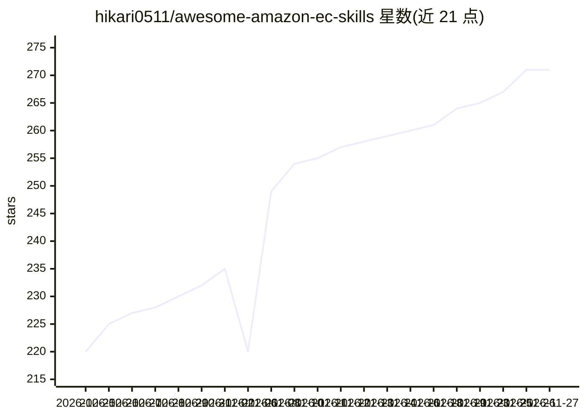

# hikari0511/awesome-amazon-ec-skills

⭐ 271 · CC0-1.0 · 推送 2026-11-19 · [GitHub](https://github.com/hikari0511/awesome-amazon-ec-skills) · 个人维护 · 中文 README

**亚马逊跨境卖家可用的 Claude AI Agent Skills 精选清单**

面向亚马逊跨境电商卖家的 AI Agent Skills 策展清单，覆盖选品、竞品、Listing、视觉、数据 BI、广告、评论等环节，并聚焦 1688 供货上游。以目录形式组织收录条目，每个条目标注免费/付费、推荐等元信息，说明 Skill、Plugin、MCP Server、Subagent 的概念与组合用法；收录设有公开仓库、license、近 6 个月有 commit 等硬门槛。仓库刚起步，正在分批收录，仅收录 Amazon + 1688 场景，不收其他平台。

## 筛选速览

| 维度 | 判定 | 备注 |
|---|---|---|
| AI 角色 | `ai-knowledge` | 知识聚合/清单类 |
| 许可风险 | `viral` | CC0-1.0 |
| 部署形态 | `None` |  |
| 模型依赖 | locked-api |  |
| 硬件要求 | — | 无带数字的原话,不猜 |
| 安装摩擦 | `low` | 无编译、无系统依赖或容器化 |
| 成熟度 | `idea` | |

## 能力要点

- 按选品/竞品/Listing/视觉/BI/广告/评论等分类组织的 skill 目录
- 说明 Skill、Plugin、MCP Server、Subagent 的定位与组合用法
- 收录硬门槛：公开 repo、兼容 license、含 SKILL.md、近 6 个月有 commit
- 含 SKILL.md 编写模板与贡献流程

## 适用场景

- 为亚马逊跨境业务挑选选品调研或 Listing 优化类 skill
- 接入 Amazon SP-API、SIF、Sorftime 等 MCP 数据源辅助运营分析
- 参考模板编写自己的亚马逊卖家 skill 并投稿

## 场景标签

`精选清单` · 领域:学习与行业

## 证据(README 行号)

> L3: # Awesome Amazon EC Skills 亚马逊跨境电商 AI Agent Skills合集
> L36: 本仓库只收录"能在 Amazon 跨境出海场景里直接落地、被社区验证过"的 skill。
> L160: **收录硬门槛**：公开 GitHub repo + 兼容 license（或作者公开声明开源）+ 含 `SKILL.md` 或同类清单 + README ≥200 字 + 近 6 个月有 commit + Amazon 跨境出

## 星数曲线

2026-10-25 220 → 2026-11-27 271（+51）

---
*卡片 v1 · prompt 1.4 · 生成 2026-11-25 · 置信度 high · 依据 README sha `f1030632a63e` · [字段定义](../../DATASET.md)*
