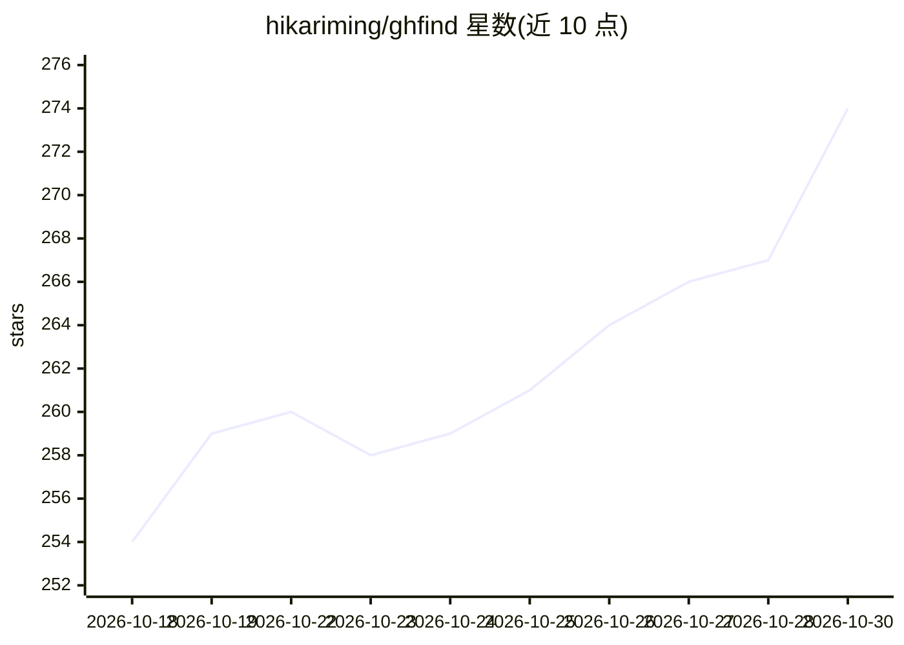

# hikariming/ghfind

⭐ 274 · TypeScript · AGPL-3.0 · 推送 2026-10-29 · [GitHub](https://github.com/hikariming/ghfind) · [官网](https://ghfind.com) · 个人维护 · 中文 README

**给 GitHub 档案打 0–100 价值/信任分并发现开发者的平台**

面向开源开发者的评估与发现平台：输入 GitHub handle，基于公开数据由确定性算法计算 0–100 分与五档评级，覆盖 6 个维度与 10 种刷量红旗，识别 PR 农场、AI 机器人与 fork 囤积者；LLM 仅做受限 ±10 校准与吐槽文案生成，不能改变基础分。附带排行榜、百分位、分享徽章、给 issue 打分的 GitHub App，并提供无 LLM 的 REST API、MCP 服务器与 npm/PyPI SDK。支持 Cloudflare Workers 自部署，CLI 需 Go 1.23+ 构建。

## 筛选速览

| 维度 | 判定 | 备注 |
|---|---|---|
| AI 角色 | `ai-enhanced` | 去掉 AI 部分产品仍成立 |
| 许可风险 | `viral` | AGPL-3.0 |
| 部署形态 | `library` | 以包/库形式分发 |
| 模型依赖 | — | README 未给出锁定关系 |
| 硬件要求 | — | 无带数字的原话,不猜 |
| 安装摩擦 | `low` | 无编译、无系统依赖或容器化 |
| 成熟度 | — | 结构信号不足 |

## 能力要点

- 确定性 0–100 评分：6 维度 + 10 种刷量红旗，倾向难伪造信号
- LLM 两段式：仅允许 ±10 受限校准，文案层不能改分
- REST API（无鉴权无 LLM）、MCP 服务器、npm/PyPI SDK
- GitHub App 按分数带给新 issue 打 review: 标签

## 适用场景

- 给自己或他人的 GitHub 档案做量化评估与差距分析
- 发现生态中值得关注的贡献者与对标开发者
- 维护者按作者分数带分流 issue 审阅队列
- 通过 MCP 让 agent 在会话内调用评分

## 场景标签

 · 领域:开发者工具/GitHub 分析

## 证据(README 行号)

> L74: - **The base score is deterministic** — computed server-side by `lib/score.ts`.
> L75: - The LLM runs in two separated passes: a factual judge may apply a bounded **±10** calibration, then a writer turn

## 星数曲线

2026-10-18 254 → 2026-10-30 274（+20）

---
*卡片 v1 · prompt 1.4 · 生成 2026-10-22 · 置信度 mid · 依据 README sha `f93515e3fd2a` · [字段定义](../../DATASET.md)*
