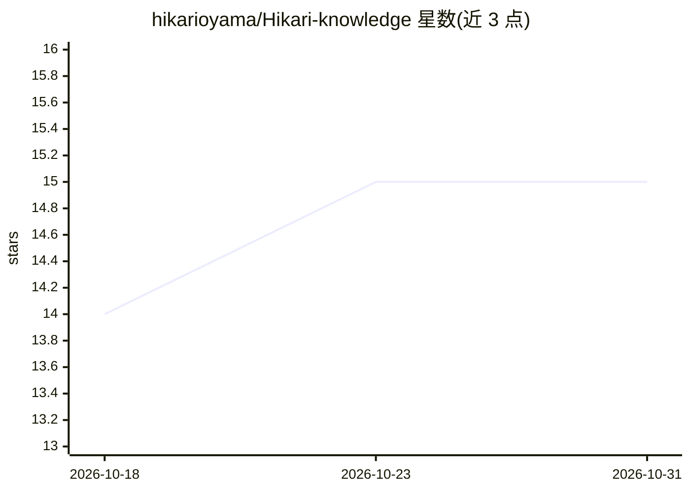

# hikarioyama/Hikari-knowledge

⭐ 15 · Python · MIT · 推送 2026-07-29 · [GitHub](https://github.com/hikarioyama/Hikari-knowledge) · 个人维护

**本地 LLM 系统的实测知识库：serving/投机解码/量化/训练/操控**

由 Hikari 个人维护的英文知识仓库，内容覆盖本地 LLM 的 serving、投机解码、量化、MoE 训练与 activation steering，形式为附带测量条件的报告、机制说明与失败记录（tombstones）。面向工程师或其 agent 复用：提供 INDEX.md 导航与 nodes/ 笔记节点、Obsidian 子目录合并工作流（git clone + 周度 pull）、供 agent 读取的 SKILL.md 文件，以及可选的本地 stdio MCP 服务器（kg_search/kg_get 等工具），MIT 许可，约每周更新。

## 筛选速览

| 维度 | 判定 | 备注 |
|---|---|---|
| AI 角色 | `ai-knowledge` | 知识聚合/清单类 |
| 许可风险 | `permissive` | MIT |
| 部署形态 | `library` | 以包/库形式分发 |
| 模型依赖 | — | README 未给出锁定关系 |
| 硬件要求 | — | 无带数字的原话,不猜 |
| 安装摩擦 | `low` | 无编译、无系统依赖或容器化 |
| 成熟度 | — | 结构信号不足 |

## 能力要点

- 每个关键数字都保留测量条件，失败以 tombstone 形式记录
- 提供 Obsidian 子目录合并与 agent 文件读取两种使用方式
- 附带可选本地 stdio MCP 服务器（kg_search/kg_get/kg_neighbors/kg_index）
- 约每周更新，以文件为事实来源

## 适用场景

- 工程师查阅带条件的本地 LLM serving 与投机解码实测数据
- 把知识库合并进自己的 Obsidian vault 并链接到项目笔记
- 让 agent 通过文件或 MCP 工具检索该知识库回答问题

## 场景标签

`知识库管理` · 领域:知识与检索

## 证据(README 行号)

> L3: Measured results, conditioned reports, and dead-end tombstones from **Hikari**'s local LLM systems work.
> L5: Serving, speculative decoding, quantization, MoE training, and activation steering — written so another engineer (or

## 星数曲线

2026-10-18 14 → 2026-10-31 15（+1）

---
*卡片 v1 · prompt 1.4 · 生成 2026-10-30 · 置信度 mid · 依据 README sha `d20110ee15f2` · [字段定义](../../DATASET.md)*
