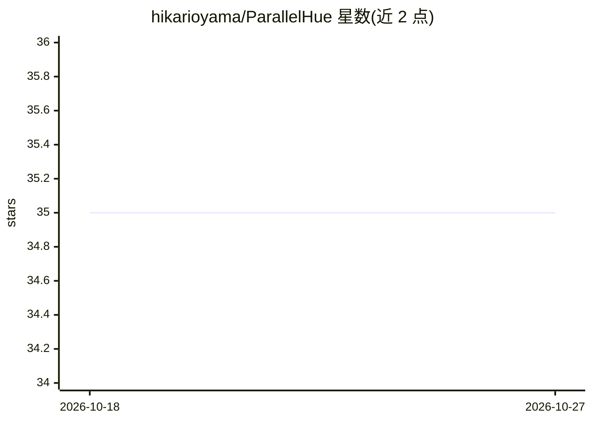

# hikarioyama/ParallelHue

⭐ 35 · Python · MIT · 推送 2026-09-06 · [GitHub](https://github.com/hikarioyama/ParallelHue) · 个人维护

**本地 LLM 流式输出的调度步着色可视化客户端**

面向本地 OpenAI 兼容流式推理的终端可视化工具：当后端（vLLM 0.26.x 或指定 GLM 镜像 fork）提供调度器与反词化器遥测时，以 `EXACT TOKEN PROVENANCE` 模式按经验证的推测解码步骤（accepted-draft/target/bonus）着色渲染并发多路流；无遥测时降级为 `SSE CHUNK MODE` 仅着色传输分块。exact 模式通过 vLLM 插件入口点与 Unix socket 获取 token ID，逐字节对账，无法对账时失败关闭。除 Python 3.10+ 标准库外无运行时依赖，支持 tmux 多窗格与 2-16 并发请求。测试矩阵覆盖 vLLM、GLM/DFlash、MTP、DSpark 等 profile。

## 筛选速览

| 维度 | 判定 | 备注 |
|---|---|---|
| AI 角色 | `ai-ecosystem` | LLM/agent 周边工具 |
| 许可风险 | `permissive` | MIT |
| 部署形态 | `self-host` | docker 或自建部署 |
| 模型依赖 | local-ok | 支持本地模型 |
| 硬件要求 | — | 无带数字的原话,不猜 |
| 安装摩擦 | `low` | 无编译、无系统依赖或容器化 |
| 成熟度 | — | 结构信号不足 |

## 能力要点

- exact 模式按调度器验证的推测解码步骤四色循环着色，区分 accepted-draft/target/bonus token 角色
- 通过 vLLM 通用插件入口点接入私有遥测契约，token ID 与 SSE 文本逐字节对账
- 遥测缺失/对账失败时 fail closed，可见降级为 SSE CHUNK MODE
- 无运行时依赖（Python 3.10+ 标准库即用），支持 tmux 多窗格最多 16 并发流

## 适用场景

- 观测本地多并发流式推理中各请求的推测解码步骤交错与停滞
- 验证推测解码后端（MTP/DSpark/DFlash）的 token 溯源正确性
- 以通用模式对比普通 OpenAI 兼容 SSE 服务器的传输分块行为

## 场景标签

`LLM 可观测性` · 领域:评测与运维

## 证据(README 行号)

> L3: ParallelHue renders a local, OpenAI-compatible streaming response with a truthful
> L92: Exact mode depends on a private, version- and capability-gated plugin contract:
> L244: ParallelHue is a **shared viewer** plus **swappable inference recipes**:

## 星数曲线

2026-10-18 35 → 2026-10-27 35（+0）

---
*卡片 v1 · prompt 1.4 · 生成 2026-10-25 · 置信度 high · 依据 README sha `a38a14ccb2cc` · [字段定义](../../DATASET.md)*
