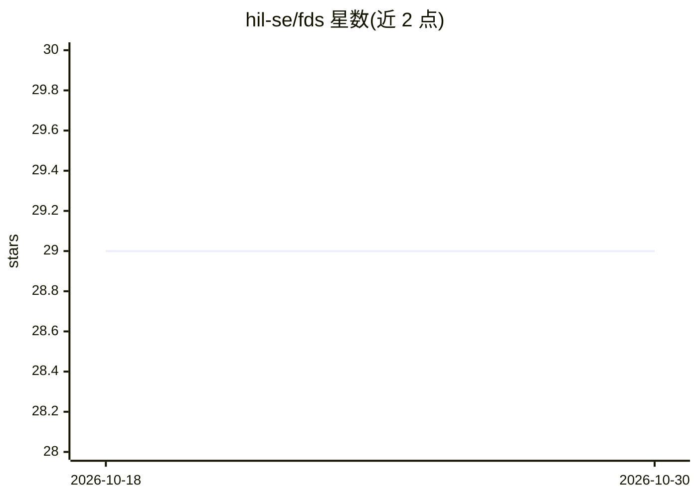

# hil-se/fds

⭐ 29 · Jupyter Notebook · MIT · 推送 2025-11-27 · [GitHub](https://github.com/hil-se/fds) · 组织维护

**数据科学基础课程仓库：大纲、幻灯片与编程作业**

RIT（DSCI-633）数据科学基础课程的教学材料仓库，提供课程大纲、幻灯片、作业与项目说明，通过 GitHub 发布并用于作业提交与讨论。内容覆盖数据预处理、分类、聚类、关联分析、异常检测、统计检验与模型验证等主题，配套一系列在实际数据集上实现算法的编程作业，采用 Tan《Introduction to Data Mining (Second Edition)》作为教材（幻灯片自足，无需购书）。作业禁止使用生成式 AI 工具，课程项目允许使用开源资源与生成式 AI。

## 筛选速览

| 维度 | 判定 | 备注 |
|---|---|---|
| AI 角色 | `ai-knowledge` | 知识聚合/清单类 |
| 许可风险 | `permissive` | MIT |
| 部署形态 | `None` |  |
| 模型依赖 | — | README 未给出锁定关系 |
| 硬件要求 | — | 无带数字的原话,不猜 |
| 安装摩擦 | `low` | 无编译、无系统依赖或容器化 |
| 成熟度 | — | 结构信号不足 |

## 能力要点

- 覆盖分类/聚类/关联分析/异常检测/统计检验等数据分析技术族
- 编程作业在多领域实际数据集上实现算法
- 通过 GitHub 发布材料并用于作业提交与答疑
- 明确生成式 AI 使用政策：作业禁用、项目允许

## 适用场景

- 按课程材料自学数据挖掘与机器学习基础算法
- 获取带实际数据集的编程作业作为练习
- 参考数据科学课程的组织方式与评分政策

## 场景标签

`教程课程` · 领域:学习与行业

## 证据(README 行号)

> L7: A foundation course in data science, emphasizing both concepts and techniques. The course provides an overview of da
> L17: The course uses Github for assignment submission, discussion, questions. Slides, assignments, and recorded videos w

## 星数曲线

2026-10-18 29 → 2026-10-30 29（+0）

---
*卡片 v1 · prompt 1.4 · 生成 2026-10-26 · 置信度 high · 依据 README sha `02044e53a873` · [字段定义](../../DATASET.md)*
