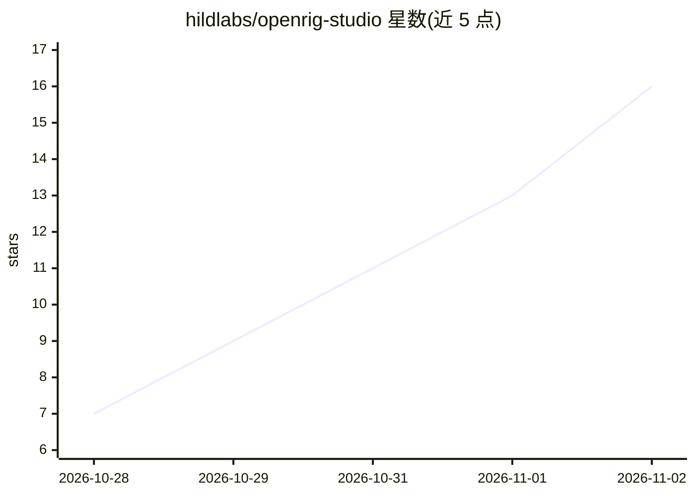

# hildlabs/openrig-studio

⭐ 16 · JavaScript · MIT · 推送 2026-10-31 · [GitHub](https://github.com/hildlabs/openrig-studio) · 组织维护

**用自有 AI 订阅生成 Roblox R15/R6 动画的桌面工具**

面向 Roblox 开发者的本地运行工具：用户描述动作，选择 Claude Code、Codex CLI 或 API key 等已有 AI 渠道，模型以 JSON 关键帧回答，经管线做归一化、IK 求解、脚步锁定、贴地与平滑处理后在 3D rig 上预览，可多模型同步对比，再通过 Roblox Studio 内置 MCP 服务器或导出 .rbxmx 发送到 Studio。支持 R15 与 R6，含剪辑库与基准脚本。限制：仅支持人形 R15/R6 rig，生成的是初稿需在 Animation Editor 打磨，Studio 桥依赖其内置 MCP 服务器，主要在 Windows 测试。

## 筛选速览

| 维度 | 判定 | 备注 |
|---|---|---|
| AI 角色 | `ai-native` | 本体是模型或模型工具 |
| 许可风险 | `permissive` | MIT |
| 部署形态 | `library` | 以包/库形式分发 |
| 模型依赖 | local-ok | 支持本地模型 |
| 硬件要求 | — | 无带数字的原话,不猜 |
| 安装摩擦 | `low` | 无编译、无系统依赖或容器化 |
| 成熟度 | — | 结构信号不足 |

## 能力要点

- 复用已有 Claude/ChatGPT 订阅或 API key，无需额外账户
- 管线做 IK、脚步锁定、贴地、缓动平滑与问题检查
- 一条提示多模型同步播放对比，含可视化二次审查
- 经 Roblox Studio 内置 MCP 服务器发送/回导剪辑

## 适用场景

- 我想用自然语言快速生成 Roblox 角色动画初稿
- 在多个 AI 模型间对比同一段动作的生成效果
- 把生成的动画直接送进 Roblox Studio 再打磨发布

## 场景标签

 · 领域:游戏开发/动画

## 证据(README 行号)

> L3: Generate Roblox R15 and R6 animations with the AI you already pay for. Describe a motion, watch it on a 3D rig, twea
> L73: 1. Your request goes to the chosen model together with a system prompt that teaches the rig (`prompts/system.md` fo

## 星数曲线

2026-10-28 7 → 2026-11-02 16（+9）

---
*卡片 v1 · prompt 1.4 · 生成 2026-10-31 · 置信度 high · 依据 README sha `4bbc15217cdf` · [字段定义](../../DATASET.md)*
