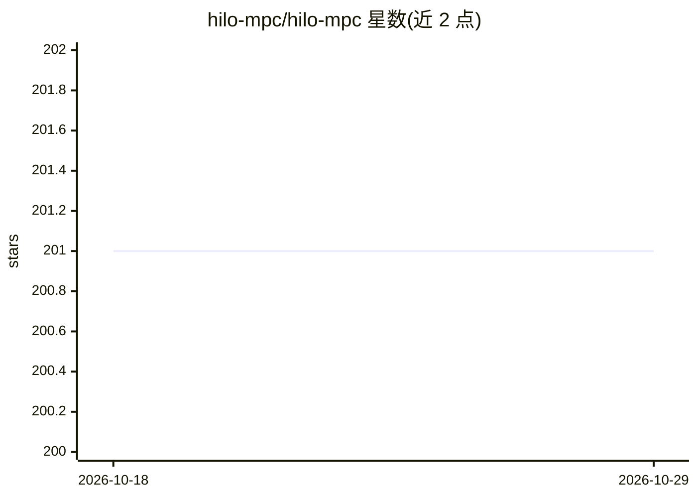

# hilo-mpc/hilo-mpc

⭐ 201 · Python · LGPL-3.0 · 推送 2026-04-03 · [GitHub](https://github.com/hilo-mpc/hilo-mpc) · [官网](https://www.ccps.tu-darmstadt.de/research_ccps/hilo_mpc/) · 组织维护

**机器学习支持的最优控制与估计 Python 工具箱**

由 TU Darmstadt 与 Otto von Guericke 大学控制实验室开发的 Python 工具箱，用于构建机器学习支持的最优控制与估计问题：支持非线性 MPC（参考跟踪、轨迹跟踪、路径跟随、经济型）、线性 MPC、移动时域估计、多种卡尔曼滤波与粒子滤波。可直连 TensorFlow/PyTorch 创建神经网络与高斯过程模型，经 CasADi 构建问题；贝叶斯/循环神经网络尚在开发中。核心依赖自动安装，ML 与绘图功能为可选 extras，Python 支持 3.10–3.12。

## 筛选速览

| 维度 | 判定 | 备注 |
|---|---|---|
| AI 角色 | `ai-enhanced` | 去掉 AI 部分产品仍成立 |
| 许可风险 | `viral` | LGPL-3.0 |
| 部署形态 | `library` | 以包/库形式分发 |
| 模型依赖 | — | README 未给出锁定关系 |
| 硬件要求 | — | 无带数字的原话,不猜 |
| 安装摩擦 | `low` | 无编译、无系统依赖或容器化 |
| 成熟度 | — | 结构信号不足 |

## 能力要点

- 非线性/线性 MPC、移动时域估计、Kalman 与粒子滤波
- 直连 TensorFlow 与 PyTorch 训练前馈神经网络与高斯过程模型
- 基于 CasADi 构建 DAE/ODE 形式的连续与离散时间问题
- 最小核心安装，ml/viz/tensorflow 等功能以 extras 按需安装

## 适用场景

- 用学习模型（神经网络/高斯过程）替代或混合机理模型做 MPC 控制
- 做移动时域估计与状态估计（EKF/UKF/粒子滤波）研究
- 复现生物反应器、搅拌釜反应器等示例并做学习型控制实验

## 场景标签

 · 领域:控制工程/科学计算

## 证据(README 行号)

> L12: HILO-MPC is a Python toolbox for **easy, flexible and fast realization of machine-learning-supported optimal contro
> L15: HILO-MPC can interface directly to TensorFlow and PyTorch

## 星数曲线

2026-10-18 201 → 2026-10-29 201（+0）

---
*卡片 v1 · prompt 1.4 · 生成 2026-10-22 · 置信度 high · 依据 README sha `2fbc3d91e834` · [字段定义](../../DATASET.md)*
