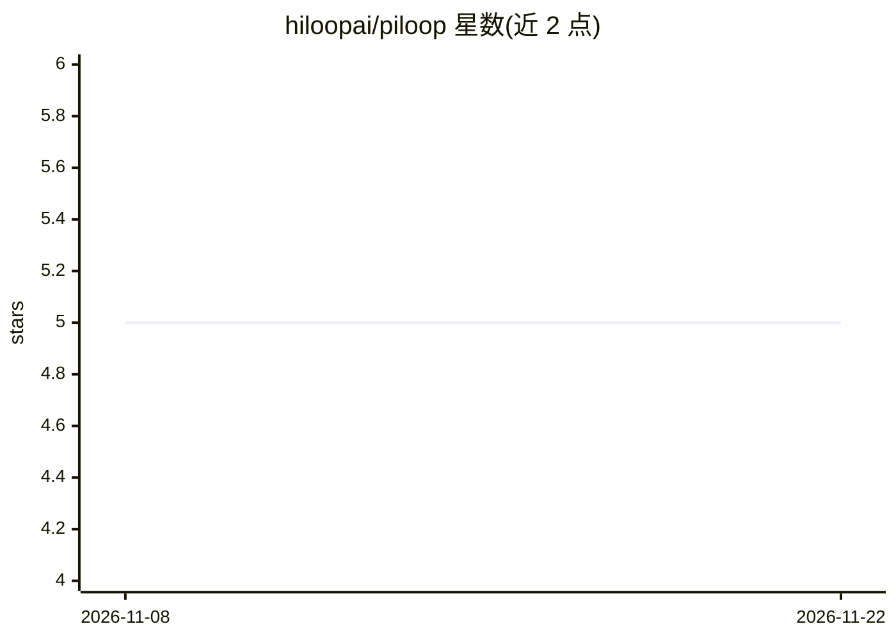

# hiloopai/piloop

⭐ 5 · Python · MIT · 推送 2026-11-21 · [GitHub](https://github.com/hiloopai/piloop) · [官网](https://piloop.autoresearch.inc) · 组织维护

**让编码 agent 尝试想法、按评估打分择优提交的工具**

piloop 面向任意 git 仓库运行自动化研究流程：多个编码 agent 各自在独立 git worktree 中尝试一个改进想法并提交；工具用用户提供的 evaluate 命令对每次提交打分，将结果存入候选池，池中得分最高的提交即为产出。状态保存在本机 SQLite 数据库与 git refs 中，无托管服务。要求 Linux glibc 2.28+ 或 Apple silicon macOS、git 2.40+、uv，以及已登录的 Claude Code 或 Codex。

## 筛选速览

| 维度 | 判定 | 备注 |
|---|---|---|
| AI 角色 | `ai-ecosystem` | LLM/agent 周边工具 |
| 许可风险 | `permissive` | MIT |
| 部署形态 | `None` |  |
| 模型依赖 | — | README 未给出锁定关系 |
| 硬件要求 | — | 无带数字的原话,不猜 |
| 安装摩擦 | `low` | 无编译、无系统依赖或容器化 |
| 成熟度 | — | 结构信号不足 |

## 能力要点

- 每个 agent 在独立 git worktree 中尝试一个想法并提交
- 用用户自定义 evaluate 命令对每次提交打分
- 状态保存在本机 SQLite 数据库与 git refs，无托管服务
- 支持 Claude Code、Codex、pi、Gemini CLI、Cursor 等编码 agent

## 适用场景

- 让编码 agent 自动迭代优化代码性能，例如压缩算法
- 对可程序化度量的目标运行多轮自动化实验
- 从多个 agent 提交中按评估得分挑选最佳提交

## 场景标签

`编码 Agent` · 领域:编码与开发

## 证据(README 行号)

> L11: piloop runs coding agents on a goal that a program can measure. Each agent tries one idea in its own git worktree
> L13: commit in the pool is the campaign's result.

## 星数曲线

2026-11-08 5 → 2026-11-22 5（+0）

---
*卡片 v1 · prompt 1.4 · 生成 2026-11-21 · 置信度 high · 依据 README sha `e9b65a562d07` · [字段定义](../../DATASET.md)*
