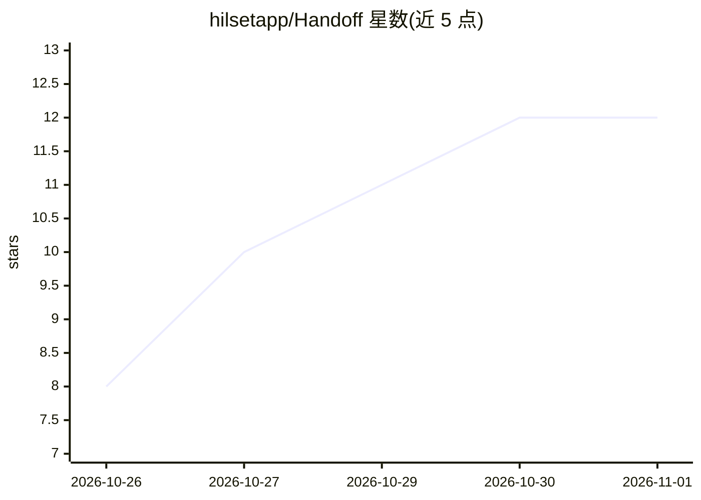

# hilsetapp/Handoff

⭐ 12 · TypeScript · MIT · 推送 2026-10-16 · [GitHub](https://github.com/hilsetapp/Handoff) · 组织维护

**为 AI 编程代理保存与共享可移植会话上下文的 CLI**

一个 npm 全局安装的命令行工具，用一条命令把 git 状态、决策记录、失败尝试、下一步任务与测试结果快照为 .handoff/HANDOFF.md 结构化 Markdown，任何能读 Markdown 的 AI 编程代理（Claude Code、Codex、Cursor、Copilot、Gemini CLI）在会话开始时读取即可延续状态。handoff sync 可将指针写入 AGENTS.md 及 claude/cursor/copilot/gemini 等代理配置文件。零遥测、两个依赖，MIT 许可。

## 筛选速览

| 维度 | 判定 | 备注 |
|---|---|---|
| AI 角色 | `ai-ecosystem` | LLM/agent 周边工具 |
| 许可风险 | `permissive` | MIT |
| 部署形态 | `library` | 以包/库形式分发 |
| 模型依赖 | — | README 未给出锁定关系 |
| 硬件要求 | — | 无带数字的原话,不猜 |
| 安装摩擦 | `low` | 无编译、无系统依赖或容器化 |
| 成熟度 | — | 结构信号不足 |

## 能力要点

- 一条命令快照 git 状态+笔记+测试结果到结构化 Markdown
- 支持 next/decision/failed/blocker 等会话记录命令
- sync 自动对接 AGENTS.md 与 claude/cursor/copilot/gemini 配置文件
- 零遥测，仅两个依赖（commander、picocolors）

## 适用场景

- 在 Cursor 探索、Claude Code 修改、Copilot 发布的多代理工作流间传递会话状态
- 记录已排除的失败方案，避免代理重复尝试
- 把会话上下文提交到 git 与团队共享

## 场景标签

`Agent 记忆` · 领域:Agent 开发

## 证据(README 行号)

> L7:  Portable session context for AI coding agents.
> L37: `handoff` maintains `.handoff/HANDOFF.md` - a structured Markdown snapshot of your working state, generated by one 
> L77: |`handoff sync [--with ...]`|Wire agent files: `AGENTS.md`, plus `claude`,`cursor`,`copilot`,`gemini`|

## 星数曲线

2026-10-26 8 → 2026-11-01 12（+4）

---
*卡片 v1 · prompt 1.4 · 生成 2026-11-01 · 置信度 high · 依据 README sha `29432575f0af` · [字段定义](../../DATASET.md)*
