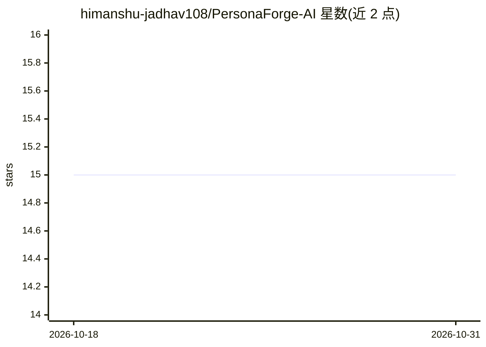

# himanshu-jadhav108/PersonaForge-AI

⭐ 15 · Python · MIT · 推送 2026-09-15 · [GitHub](https://github.com/himanshu-jadhav108/PersonaForge-AI) · 个人维护

**本地离线运行的视频/图像人脸替换系统（FastAPI+ONNX）**

基于 FastAPI、ONNX Runtime 与 FFmpeg 的本地人脸替换平台：上传源人脸与目标视频，经人脸检测、ArcFace 512D 嵌入的身份聚类、指定个体定向替换与模块化融合（Poisson/羽化/Alpha）后输出 MP4，支持 GFPGAN/CodeFormer 面部修复适配器与 5 分量完整性评分。GPU（CUDA Tensor Core）与 CPU 双管线，内存流式处理避免落盘，提供 REST API、WebSocket 直播与 Docker Compose 部署；限制：需本地模型资产，AI 修复在权重缺失时禁用。

## 筛选速览

| 维度 | 判定 | 备注 |
|---|---|---|
| AI 角色 | `ai-native` | 本体是模型或模型工具 |
| 许可风险 | `permissive` | MIT |
| 部署形态 | `self-host` | docker 或自建部署 |
| 模型依赖 | — | README 未给出锁定关系 |
| 硬件要求 | — | 无带数字的原话,不猜 |
| 安装摩擦 | `low` | 无编译、无系统依赖或容器化 |
| 成熟度 | — | 结构信号不足 |

## 能力要点

- ArcFace 512D 嵌入身份聚类与指定个体定向替换
- Fast/Balanced/High Quality 三档处理模式（含实测吞吐数据）
- 内存零落盘流式管线直写 FFmpeg 管道
- REST API + WebSocket 直播 + 5 分量完整性评分报告

## 适用场景

- 在本地离线对视频做指定人物的换脸处理
- 多人视频中只替换选中的个体，保留其他人物
- 生成 3-5 秒预览片段后再执行完整处理

## 场景标签

`图像视频处理` · 领域:感知与多模态

## 证据(README 行号)

> L33: **PersonaForge AI** is a flagship-grade, open-source computer vision engineering platform engineered for real-time,
> L159: |`POST`|`/process`|Initiates full video face transformation pipeline|

## 星数曲线

2026-10-18 15 → 2026-10-31 15（+0）

---
*卡片 v1 · prompt 1.4 · 生成 2026-10-30 · 置信度 high · 依据 README sha `65a5f290e6d1` · [字段定义](../../DATASET.md)*
