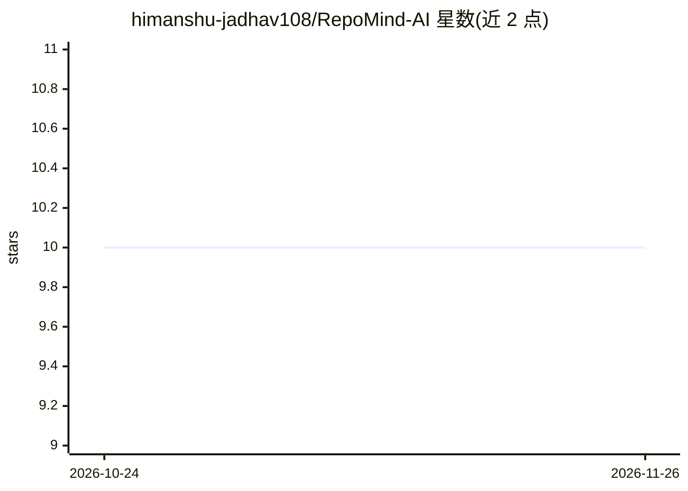

# himanshu-jadhav108/RepoMind-AI

⭐ 10 · TypeScript · 推送 2026-08-21 · [GitHub](https://github.com/himanshu-jadhav108/RepoMind-AI) · [官网](https://repomind-ai-ten.vercel.app) · 个人维护

**把 GitHub 仓库变成 3D 架构图与可解释审计报告的多智能体平台**

面向开发者与代码评审者的 Web 平台：提交 GitHub 仓库 URL 后，由 LangGraph 状态机编排的 10 个专用 AI 智能体完成克隆、多语言符号抽取、NetworkX 依赖图构建与安全/架构/性能/文档并行审计，输出 0-100 健康评分（6 项加权子分）、5 种图视图（含 3D WebGL 星系图）与逐条带证据行、置信度的可解释发现，并支持 HTML/Markdown/PDF 一键导出。FastAPI 后端 + React 前端，已部署 Live 站点与 Swagger 文档。

## 筛选速览

| 维度 | 判定 | 备注 |
|---|---|---|
| AI 角色 | `ai-native` | 本体是模型或模型工具 |
| 许可风险 | `none` | — |
| 部署形态 | `self-host` | docker 或自建部署 |
| 模型依赖 | locked-api |  |
| 硬件要求 | — | 无带数字的原话,不猜 |
| 安装摩擦 | `low` | 无编译、无系统依赖或容器化 |
| 成熟度 | — | 结构信号不足 |

## 能力要点

- 10 个 LangGraph 编排的专用智能体（规划/分析/架构/安全/性能/文档/评审等）
- 带自动故障转移的 5 家 LLM 提供商路由（Gemini/Groq/OpenAI/OpenRouter/HuggingFace）
- 每条发现附 reasoning、confidence、源码证据行与影响路径
- 3D WebGL 星系图与 2D ER 树共 5 种图布局引擎

## 适用场景

- 接手陌生仓库时快速生成架构图谱与健康评分
- 代码评审前自动做安全与性能审计并导出报告
- 新人上手时用 Learning Agent 逐行理解代码

## 场景标签

`多智能体` `代码审查` · 领域:Agent 开发

## 证据(README 行号)

> L23: _Transform any GitHub repository into an interactive, 3D-visualized, fully audited engineering workspace — powered 
> L71: When a developer or reviewer submits any GitHub repository URL, RepoMind AI deploys a team of **10 specialized AI a
> L98: - State-machine orchestrated multi-agent workflow powered by **LangGraph**. Delegates work to specialized agents fo

## 星数曲线

2026-10-24 10 → 2026-11-26 10（+0）

---
*卡片 v1 · prompt 1.4 · 生成 2026-11-19 · 置信度 high · 依据 README sha `08093de4de2e` · [字段定义](../../DATASET.md)*
