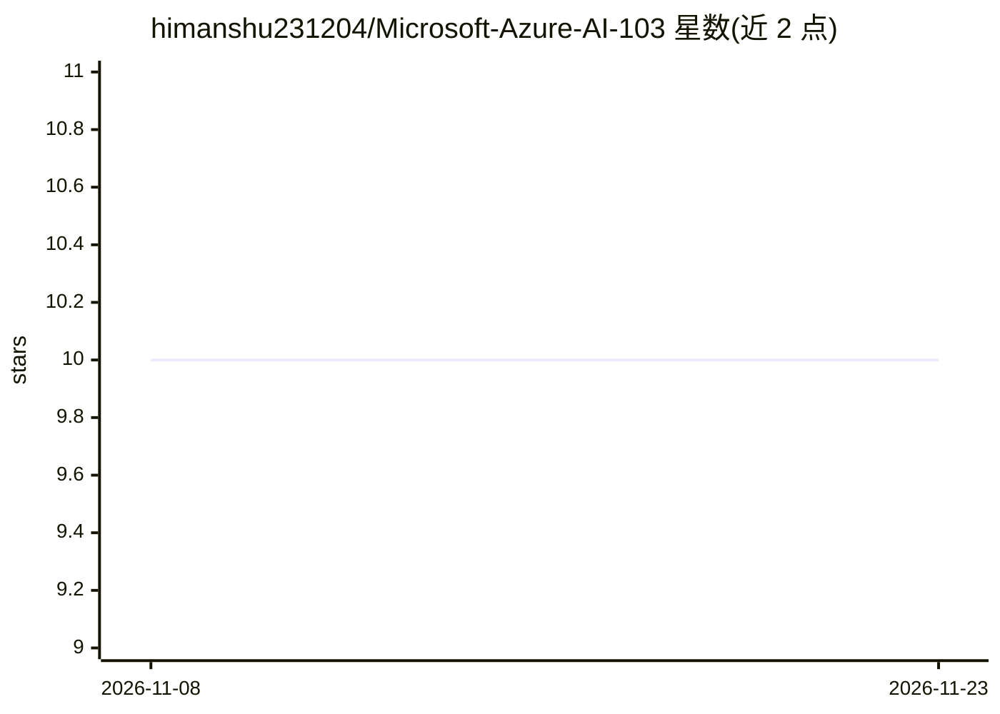

# himanshu231204/Microsoft-Azure-AI-103

⭐ 10 · TypeScript · MIT · 推送 2026-11-14 · [GitHub](https://github.com/himanshu231204/Microsoft-Azure-AI-103) · 个人维护

**面向 AI-103 认证考生的 Azure AI 工程师课程学习笔记**

为微软 AI-103T00-A 认证考试整理的学习笔记仓库，覆盖 4 条学习路径共 34 个模块：Azure 生成式 AI 应用开发（8 模块）、AI Agent 开发（9 模块）、自然语言方案（9 模块）、视觉数据洞察提取（8 模块）。每个模块配有状态表、笔记链接与练习题入口，另含考试技能清单（5 个 section）、600+ 行的 Agent 深入笔记（agentic AI、MCP、多 Agent、生产模式）、8 级动手项目路线图（azd 部署）及进度跟踪表。截至记录时完成 10/34 模块。

## 筛选速览

| 维度 | 判定 | 备注 |
|---|---|---|
| AI 角色 | `ai-knowledge` | 知识聚合/清单类 |
| 许可风险 | `permissive` | MIT |
| 部署形态 | `None` |  |
| 模型依赖 | — | README 未给出锁定关系 |
| 硬件要求 | — | 无带数字的原话,不猜 |
| 安装摩擦 | `low` | 无编译、无系统依赖或容器化 |
| 成熟度 | — | 结构信号不足 |

## 能力要点

- 34 个模块按 4 条学习路径组织并跟踪完成状态
- 600+ 行 Agents Deep-Dive 笔记覆盖 agentic AI、MCP、多 Agent 与生产模式
- 8 级动手项目路线图：从提示词 Agent 到 azd 部署的生产级 Agent
- 每个模块附 50 题练习入口

## 适用场景

- 备考微软 AI-103 认证考试
- 按官方课程结构系统学习 Azure AI Foundry 开发
- 查找 MCP、多 Agent 编排等主题的学习资料

## 场景标签

`教程课程` · 领域:学习与行业

## 证据(README 行号)

> L12: **Pass exam (score ≥700) + build production-grade AI agent skills**
> L16: The course has **4 learning paths** with **34 modules total**:

## 星数曲线

2026-11-08 10 → 2026-11-23 10（+0）

---
*卡片 v1 · prompt 1.4 · 生成 2026-11-19 · 置信度 high · 依据 README sha `a78901ba367d` · [字段定义](../../DATASET.md)*
