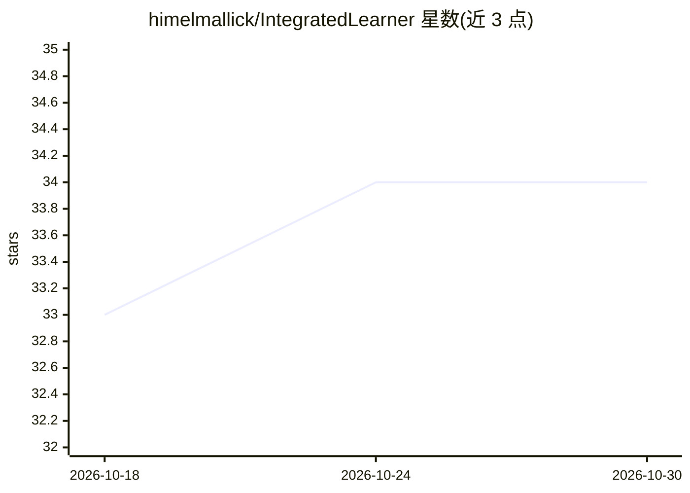

# himelmallick/IntegratedLearner

⭐ 34 · R · NOASSERTION · 推送 2026-10-27 · [GitHub](https://github.com/himelmallick/IntegratedLearner) · 个人维护

**多组学预测与分类的 R 机器学习集成框架**

Bioconductor 生态的 R 包，为多组学数据（宏基因组、代谢组等）提供单一高层接口，支持二分类、多分类、连续与生存结局的预测和分类。以 MultiAssayExperiment 为主输入模式（保留 PCL 兼容），提供早融合与晚融合两种整合范式，晚融合为逐层基学习器加元学习器堆叠（默认 BART 基学习器与 sl_nnls_auc 元学习器）；集成 SuperLearner、原生多分类后端与生存后端 ILsurv，另可通过 multiview 包做协作学习。支持折内安全筛选、嵌套交叉验证、层权重与特征重要性输出；并行化标注为尚不可用。BART 功能需 Java 环境，不可用时可换其他学习器。

## 筛选速览

| 维度 | 判定 | 备注 |
|---|---|---|
| AI 角色 | `ai-native` | 本体是模型或模型工具 |
| 许可风险 | `none` | NOASSERTION |
| 部署形态 | `None` |  |
| 模型依赖 | — | README 未给出锁定关系 |
| 硬件要求 | — | 无带数字的原话,不猜 |
| 安装摩擦 | `low` | 无编译、无系统依赖或容器化 |
| 成熟度 | — | 结构信号不足 |

## 能力要点

- 单一接口支持二分类/多分类/连续/生存四类结局
- 早融合与晚融合两种整合范式，晚融合默认 sl_bart + sl_nnls_auc
- 集成 SuperLearner、原生多分类后端与 ILsurv 生存后端
- 折内安全的特征过滤与监督筛选，避免信息泄漏

## 适用场景

- 用多个组学数据层训练预测模型并评估性能
- 量化各组学层在融合模型中的贡献权重
- 生存结局的多组学整合建模与风险预测

## 场景标签

 · 领域:生物信息学/多组学机器学习

## 证据(README 行号)

> L3: The repository houses the **`IntegratedLearner`** R package for multi-omics prediction and classification. Binary, m
> L44: * Supports binary, multiclass, continuous, and survival outcomes
> L63: **`IntegratedLearner`** provides an integrated machine learning framework to 1) consolidate predictions by borrowin

## 星数曲线

2026-10-18 33 → 2026-10-30 34（+1）

---
*卡片 v1 · prompt 1.4 · 生成 2026-10-25 · 置信度 high · 依据 README sha `2c694e42a6fd` · [字段定义](../../DATASET.md)*
