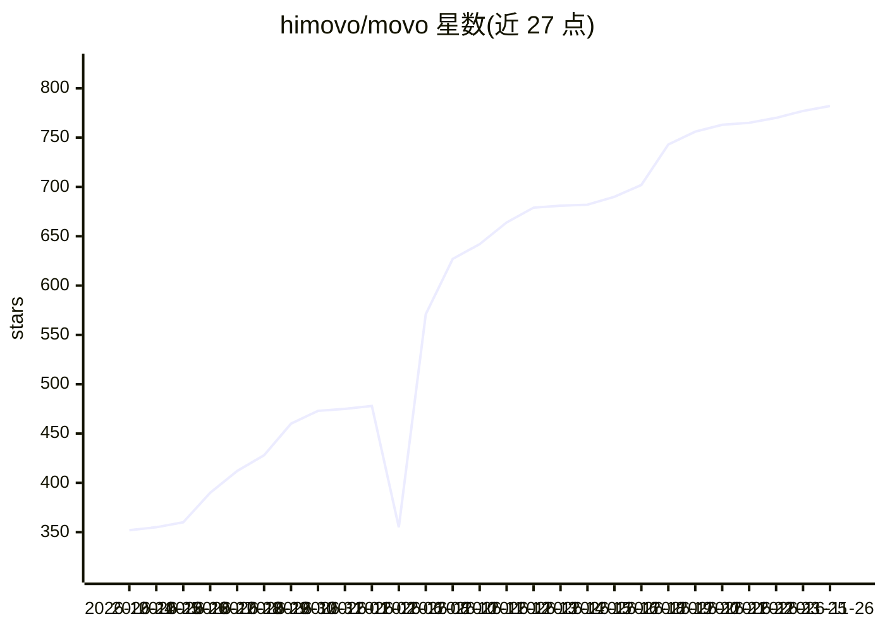

# himovo/movo

⭐ 782 · Python · NOASSERTION · 推送 2026-11-20 · [GitHub](https://github.com/himovo/movo) · [官网](https://www.himovo.com) · 组织维护 · 中文 README

**把 DeepSeek Harness 变成可自托管的企业级 Agent 平台**

基于 DeepSeek Harness（DSH）的自托管企业 Agent 平台社区版，捆绑 DSH Runtime Host、用户工作区、管理控制台、企业知识库、文档解析与检索服务，通过 Docker Compose 一次性启动 12 个服务。提供知识问答与多轮研究（带引用）、多格式文档解析、报告/PPTX/表格等内容生成、Skills/Tools/MCP 接入、任务调度、敏感操作审批与审计。Windows 需在 WSL 2 的 Ubuntu 中运行；Browser Agent 与 Code Agent 需另行安装不在本仓库内的专有 MOVO Desktop。

## 筛选速览

| 维度 | 判定 | 备注 |
|---|---|---|
| AI 角色 | `ai-ecosystem` | LLM/agent 周边工具 |
| 许可风险 | `none` | NOASSERTION |
| 部署形态 | `self-host` | docker 或自建部署 |
| 模型依赖 | — | README 未给出锁定关系 |
| 硬件要求 | — | 无带数字的原话,不猜 |
| 安装摩擦 | `low` | 无编译、无系统依赖或容器化 |
| 成熟度 | — | 结构信号不足 |

## 能力要点

- 内置 DSH Runtime，支持规划、工具调用、Skills、子 Agent 与受治理执行
- 企业知识检索与多轮研究，保留引用并支持核查证据
- 解析 PDF/DOCX/XLSX/PPTX/CSV/Markdown 及图像图表，生成报告、PPTX、表格等交付物
- 组织/用户/角色/模型/配额/审计的企业管理与敏感工具操作审批

## 适用场景

- 企业内部知识问答与制度、项目资料检索
- 多来源研究与竞争分析并产出报告
- 电子表格处理、翻译与模板填充
- 通过 MCP/HTTP 将 Agent 连接到业务系统并管控执行

## 场景标签

`工作流自动化` `文档解析` `RAG` · 领域:效率与自动化

## 证据(README 行号)

> L5:  A self-hosted enterprise Agent platform built on DeepSeek Harness (DSH).
> L17: MOVO brings DSH Agents from development experiments into enterprise production. It combines the DSH Runtime, Skills
> L119: The default Docker Compose deployment starts 12 services: the gateway, two Web applications, three application API

## 星数曲线

2026-10-24 352 → 2026-11-26 782（+430）

---
*卡片 v1 · prompt 1.4 · 生成 2026-11-24 · 置信度 high · 依据 README sha `7542d42311fe` · [字段定义](../../DATASET.md)*
