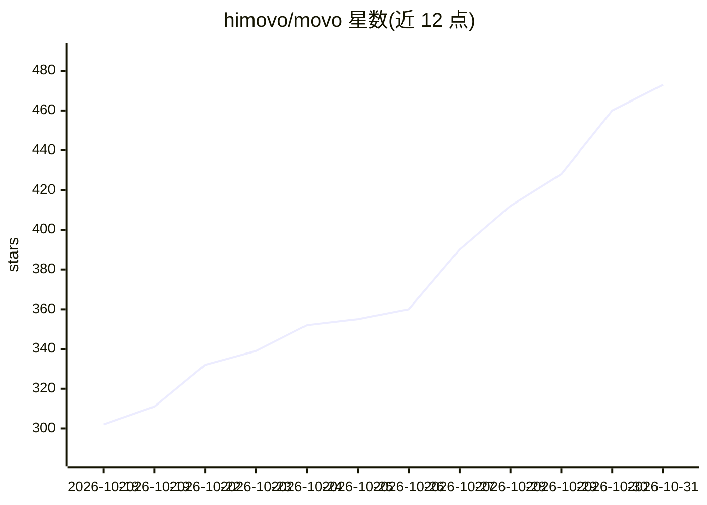

# himovo/movo

⭐ 473 · Python · NOASSERTION · 推送 2026-10-30 · [GitHub](https://github.com/himovo/movo) · [官网](https://www.himovo.com) · 组织维护 · 中文 README

**自托管企业 Agent 平台：在 DSH 运行时上交付知识问答与自动化**

构建于 DeepSeek Harness（DSH）之上的自托管企业 Agent 平台社区版：打包 DSH Runtime Host，叠加用户工作台、管理控制台、企业知识库（PDF/DOCX/XLSX 等解析与检索）、深度研究、内容与文件生成（PPTX/表格/PDF）、任务调度与审批治理、组织/用户/模型/审计等管理功能。通过 git clone 加 ./movo up 以 Docker Compose 拉起 12 个官方预构建镜像服务，无需 .env 或本地构建。Browser Agent 与 Code Agent 需另行安装闭源分发的 MOVO Desktop 才可用。

## 筛选速览

| 维度 | 判定 | 备注 |
|---|---|---|
| AI 角色 | `ai-native` | 本体是模型或模型工具 |
| 许可风险 | `none` | NOASSERTION |
| 部署形态 | `self-host` | docker 或自建部署 |
| 模型依赖 | locked-api |  |
| 硬件要求 | — | 无带数字的原话,不猜 |
| 安装摩擦 | `low` | 无编译、无系统依赖或容器化 |
| 成熟度 | — | 结构信号不足 |

## 能力要点

- 打包 DSH Runtime Host，提供规划、工具调用、Skills、子 Agent 能力
- 企业知识库与深度研究：文档解析、多源检索、引用与证据留痕
- 治理与管理：任务调度、敏感操作审批、组织/用户/模型/审计管理
- Docker Compose 一键部署 12 个预构建镜像服务，无需本地构建

## 适用场景

- 在企业内自托管部署带知识库的问答与研究平台
- 生成报告、演示文稿、表格等交付物并留存痕迹
- 按组织、角色、配额与审计要求管理员工的 Agent 使用

## 场景标签

`工作流自动化` `文档问答` · 领域:效率与自动化

## 证据(README 行号)

> L5:  A self-hosted enterprise Agent platform built on DeepSeek Harness (DSH).
> L17: MOVO brings DSH Agents from development experiments into enterprise production. It combines the DSH Runtime, Skills
> L71: |Enterprise knowledge and research|Search internal documents and public sources, run multi-round research, retain c

## 星数曲线

2026-10-18 302 → 2026-10-31 473（+171）

---
*卡片 v1 · prompt 1.4 · 生成 2026-10-21 · 置信度 high · 依据 README sha `0402730e2ce8` · [字段定义](../../DATASET.md)*
