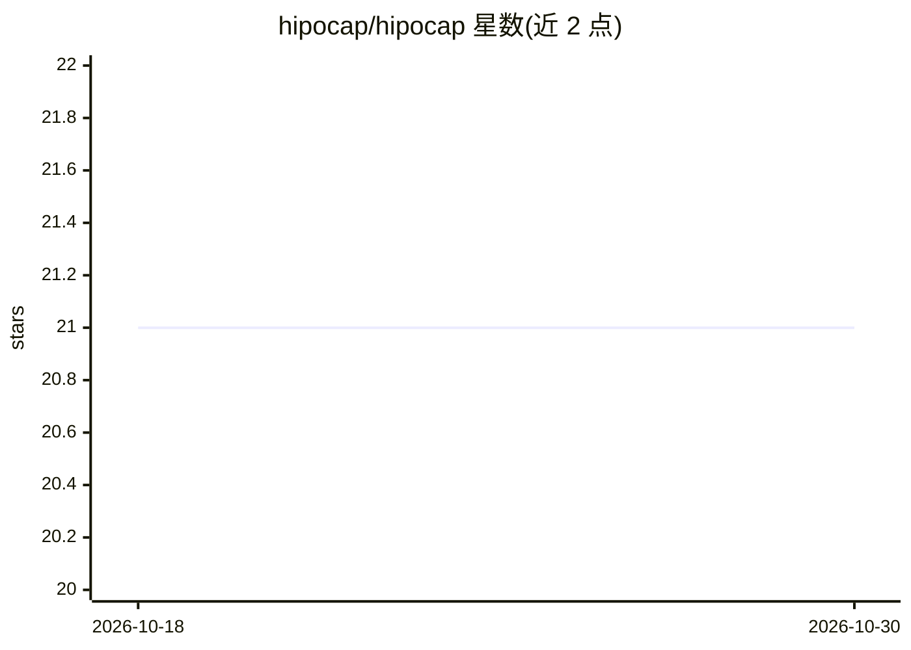

# hipocap/hipocap

⭐ 21 · TypeScript · Apache-2.0 · 推送 2026-08-07 · [GitHub](https://github.com/hipocap/hipocap) · [官网](https://hipocap.com) · 组织维护

**面向 LLM 应用的安全治理与可观测平台：防提示注入**

HipoCap 是面向 LLM 应用的 DevSecOps 与可观测性平台：通过多阶段防御管线（Prompt Guard、LLM 分析、隔离感染模拟、自定义 Shield）检测 14 类威胁（S1-S14）的提示注入攻击；提供基于角色的治理（函数级权限、策略规则、函数链限制、审计）；可观测性部分采用 OpenTelemetry 原生追踪，支持 OpenAI/Anthropic/LangChain 自动插桩，可 SQL 访问追踪数据。部署方式为 Docker Compose 多服务（前端、服务器、PostgreSQL、ClickHouse、Quickwit），并提供 Python SDK（pip 安装），使用前需在仪表盘创建至少一个 Policy。

## 筛选速览

| 维度 | 判定 | 备注 |
|---|---|---|
| AI 角色 | `ai-ecosystem` | LLM/agent 周边工具 |
| 许可风险 | `permissive` | Apache-2.0 |
| 部署形态 | `self-host` | docker 或自建部署 |
| 模型依赖 | — | README 未给出锁定关系 |
| 硬件要求 | — | 无带数字的原话,不猜 |
| 安装摩擦 | `low` | 无编译、无系统依赖或容器化 |
| 成熟度 | — | 结构信号不足 |

## 能力要点

- 多阶段防御管线与 14 类威胁（S1-S14）检测
- 基于 Prompt 的自定义 Shield 阻断直接提示注入
- OpenTelemetry 原生追踪与 SQL 访问追踪数据
- 函数级 RBAC、函数链规则与审计日志

## 适用场景

- 在用户输入到达 LLM 前检测并阻断提示注入
- 为 LLM 应用配置函数级权限与调用链策略
- 在统一面板查看 LLM 调用追踪与安全分析结果

## 场景标签

`网络安全` `LLM 可观测性` · 领域:评测与运维

## 证据(README 行号)

> L9: HipoCap is an AI security and observability platform that protects your LLM applications from prompt injection attac
> L22: - [x] 📊 **Observability** - OpenTelemetry-native tracing
> L23:  - [x] Automatic instrumentation for **OpenAI, Anthropic, LangChain, and more**

## 星数曲线

2026-10-18 21 → 2026-10-30 21（+0）

---
*卡片 v1 · prompt 1.4 · 生成 2026-10-28 · 置信度 high · 依据 README sha `b78de3f74e95` · [字段定义](../../DATASET.md)*
