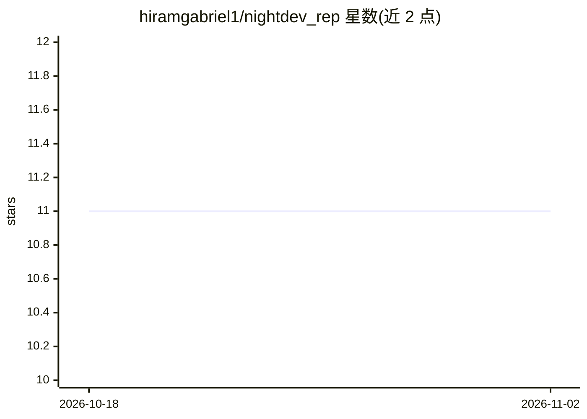

# hiramgabriel1/nightdev_rep

⭐ 11 · TypeScript · MIT · 推送 2026-08-01 · [GitHub](https://github.com/hiramgabriel1/nightdev_rep) · 个人维护

**Telegram 机器人：AI agent 在隔离容器中代用户写码并推送 GitHub**

Nightdev 是一个 TypeScript 编写的 Telegram 机器人，用户以自然语言下达需求，主 agent 在 VPS 上编排 builder、tester、committer 等多个 AI agent 完成编码、测试并提交到 GitHub。每位用户获得独立 Docker 容器实现隔离，新用户首次消息即自动配置并赠送 100,000 token；token 耗尽后可自带 Anthropic/OpenAI/Gemini/DeepSeek 等 API key。基础设施基于 Dokploy（Docker Swarm）、PM2、Terraform（DigitalOcean）以代码方式管理，本地运行需 Node.js 20+、pnpm 8+ 与 PostgreSQL。

## 筛选速览

| 维度 | 判定 | 备注 |
|---|---|---|
| AI 角色 | `ai-ecosystem` | LLM/agent 周边工具 |
| 许可风险 | `permissive` | MIT |
| 部署形态 | `self-host` | docker 或自建部署 |
| 模型依赖 | — | README 未给出锁定关系 |
| 硬件要求 | — | 无带数字的原话,不猜 |
| 安装摩擦 | `low` | 无编译、无系统依赖或容器化 |
| 成熟度 | — | 结构信号不足 |

## 能力要点

- 主 agent 编排 builder/tester/committer 多 agent 流水线
- 每用户独立 Docker 容器隔离运行
- 新用户自动配置并赠送 100,000 token，可自带 API key
- Terraform + Dokploy 一条命令完成 VPS 基础设施部署

## 适用场景

- 在手机上通过 Telegram 让 AI 代为构建并提交代码
- 让 bot 自动创建 GitHub 仓库、管理分支并推送
- 用自己的 API key 隔离运行专属 AI 编码 agent

## 场景标签

`编码 Agent` `多智能体` · 领域:Agent 开发

## 证据(README 行号)

> L17: - **Multiple agents** — A main agent orchestrates builders, testers, and committers automatically
> L182: - **AI Agents**: OpenClaw on VPS (multi-agent: main, builder, tester, committer)

## 星数曲线

2026-10-18 11 → 2026-11-02 11（+0）

---
*卡片 v1 · prompt 1.4 · 生成 2026-11-02 · 置信度 high · 依据 README sha `4a80cabc4b1a` · [字段定义](../../DATASET.md)*
