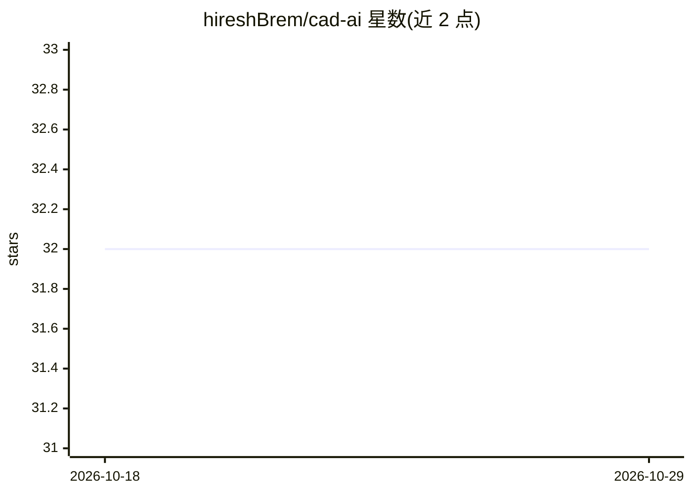

# hireshBrem/cad-ai

⭐ 32 · TypeScript · 推送 2025-12-15 · [GitHub](https://github.com/hireshBrem/cad-ai) · 个人维护

**用自然语言生成 CAD 模型的 AI 设计助手（'Cursor for CAD'）**

基于 Next.js 16 + Mastra SDK + Vercel AI SDK 构建的 Web 应用：用户输入自然语言提示（如'创建一个 50mm 直径、6 个 M8 螺栓孔的法兰'），通过 OpenAI API 与 KittyCAD API 生成 CAD 设计。运行需要 Redis（docker 启动）、OpenAI 与 KittyCAD 的 API key；安装方式为 git clone 源码 + npm install 后 npm run dev 本地运行，无打包发布。面向希望以对话方式产出 CAD 模型的工程用户。

## 筛选速览

| 维度 | 判定 | 备注 |
|---|---|---|
| AI 角色 | `ai-native` | 本体是模型或模型工具 |
| 许可风险 | `none` | — |
| 部署形态 | `self-host` | docker 或自建部署 |
| 模型依赖 | — | README 未给出锁定关系 |
| 硬件要求 | — | 无带数字的原话,不猜 |
| 安装摩擦 | `low` | 无编译、无系统依赖或容器化 |
| 成熟度 | — | 结构信号不足 |

## 能力要点

- 自然语言提示生成 CAD 设计（法兰、齿轮、支架等示例）
- 依赖 OpenAI API 与 KittyCAD API
- Next.js 16 App Router + Mastra SDK + Vercel AI SDK 技术栈

## 适用场景

- 用一句话描述快速生成法兰、齿轮等 CAD 模型
- 工程师以对话方式迭代机械零件设计

## 场景标签

`代码生成` · 领域:编码与开发

## 证据(README 行号)

> L3: AI-powered CAD design assistant. This project lets you create CAD designs using AI.
> L54: - "Create a flange with a 50mm diameter, 6 holes for M8 bolts, and 10mm thickness"

## 星数曲线

2026-10-18 32 → 2026-10-29 32（+0）

---
*卡片 v1 · prompt 1.4 · 生成 2026-10-26 · 置信度 mid · 依据 README sha `2695212b93ec` · [字段定义](../../DATASET.md)*
