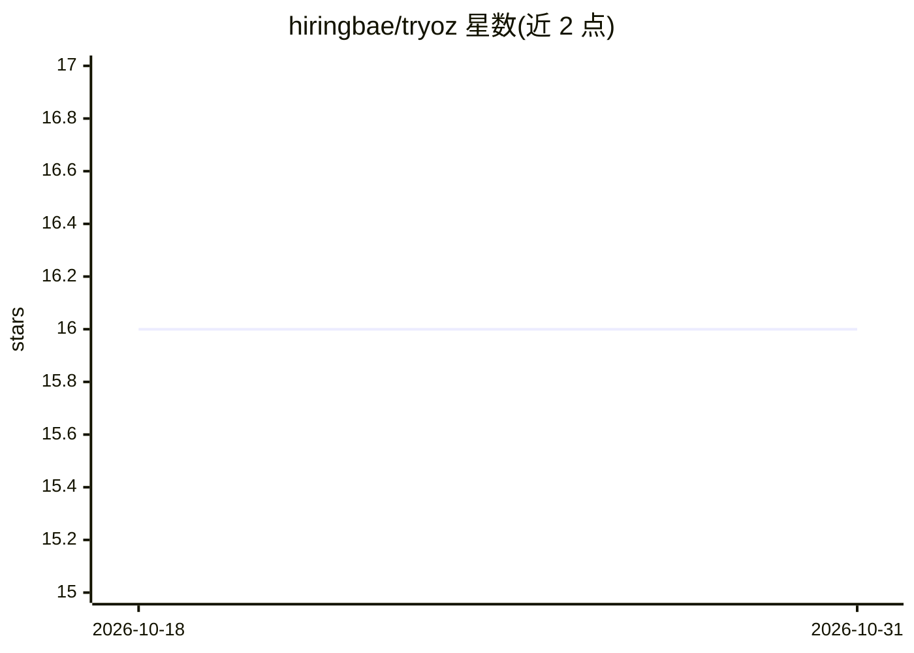

# hiringbae/tryoz

⭐ 16 · JavaScript · MIT · 推送 2026-06-16 · [GitHub](https://github.com/hiringbae/tryoz) · [官网](https://tryoz.dev) · 个人维护

**为编码 agent 一行命令配置 Oz 文档 MCP 服务器的安装器**

npm CLI 工具，通过交互式向导为已安装的编码 agent（Codex、Claude Code、Cursor、Copilot、Cline 等 11 类）写入 Oz MCP 配置并安装对应 skill/规则文件。Oz 本体是托管服务端，提供版本感知的第三方库/SDK/API 文档检索，让 agent 在回答外部依赖问题时优先查当前文档而非训练数据。本仓库仅含 setup CLI、技能模板与文档，索引后端与向量库为独立服务组件。

## 筛选速览

| 维度 | 判定 | 备注 |
|---|---|---|
| AI 角色 | `ai-ecosystem` | LLM/agent 周边工具 |
| 许可风险 | `permissive` | MIT |
| 部署形态 | `library` | 以包/库形式分发 |
| 模型依赖 | — | README 未给出锁定关系 |
| 硬件要求 | — | 无带数字的原话,不猜 |
| 安装摩擦 | `low` | 无编译、无系统依赖或容器化 |
| 成熟度 | — | 结构信号不足 |

## 能力要点

- 交互式向导检测已安装 agent 并写入 MCP 配置
- 支持 11 类编码 agent 的全局/项目两种作用域
- 安装 Oz skill 与各 agent 对应的规则回退文件
- 用 tools/list 验证 MCP 服务器连通，支持 --no-telemetry

## 适用场景

- 给 Claude Code / Codex / Cursor 等编码 agent 一键接入 Oz 文档 MCP
- 让编码 agent 回答库 API 问题时引用当前版本文档
- 为整个工具链统一配置文档检索通道

## 场景标签

 · 领域:开发者工具/MCP 接入

## 证据(README 行号)

> L10: One-line setup for Oz, a version-aware documentation MCP server for coding agents.
> L47: 1. Detects installed coding agents.

## 星数曲线

2026-10-18 16 → 2026-10-31 16（+0）

---
*卡片 v1 · prompt 1.4 · 生成 2026-10-30 · 置信度 high · 依据 README sha `7377d1ae3c7f` · [字段定义](../../DATASET.md)*
