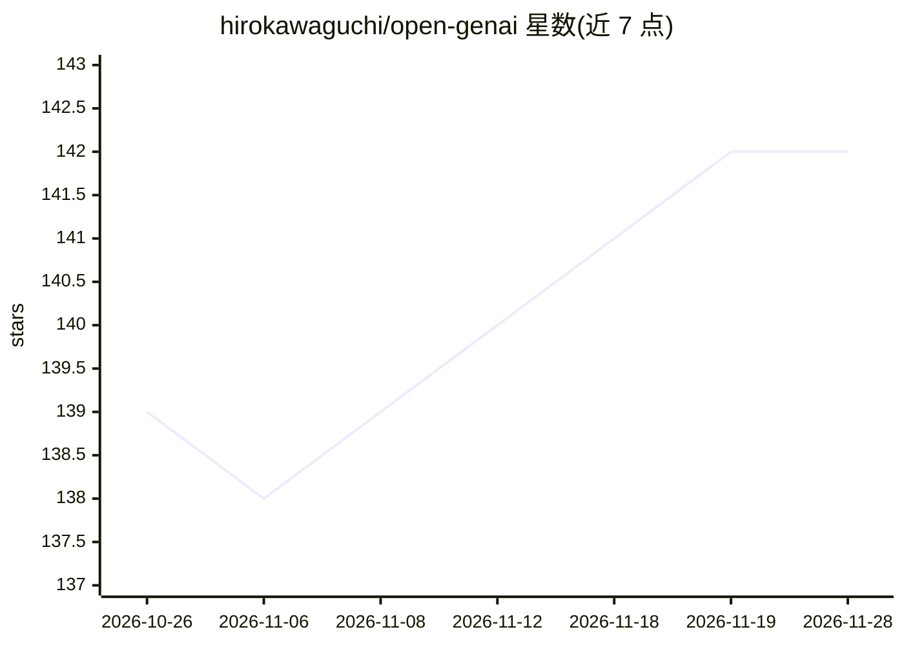

# hirokawaguchi/open-genai

⭐ 142 · TypeScript · MIT · 推送 2026-11-25 · [GitHub](https://github.com/hirokawaguchi/open-genai) · 个人维护

**让日本数字厅源内(GENAI)完全本地化运行的非官方项目**

将数字厅开源的政府 AI「源内(GENAI)」改为完全本地运行的非官方 fork：以 Keycloak 承接 SAML 认证、FastAPI 后端替代云端 API、Ollama 等 OpenAI 互接口作为 LLM 后端，Qdrant 提供 RAG、faster-whisper 提供文字转录、Stable Diffusion 提供图像生成。面向自治体/闭网环境运营，提供审计日志、CSV 用户管理、模型使用控制、禁语/个人信息检测等治理功能，通过 docker-compose 提供开发、TLS 生产与 HTTP 验证三种部署配置。

## 筛选速览

| 维度 | 判定 | 备注 |
|---|---|---|
| AI 角色 | `ai-ecosystem` | LLM/agent 周边工具 |
| 许可风险 | `permissive` | MIT |
| 部署形态 | `self-host` | docker 或自建部署 |
| 模型依赖 | local-ok | 支持本地模型 |
| 硬件要求 | — | 无带数字的原话,不猜 |
| 安装摩擦 | `low` | 无编译、无系统依赖或容器化 |
| 成熟度 | — | 结构信号不足 |

## 能力要点

- 用 Keycloak+FastAPI+Ollama/Qdrant/SeaweedFS 替换 Cognito/Bedrock/DynamoDB/S3 等云依赖
- 面向自治体的治理功能：审计日志、CSV 用户管理、模型策略、禁语与 PII 检测
- 多租户（栋）+ 团队模型，RAG 知识与聊天记录按栋隔离
- 提供 MCP 接口（知识检索、手続きマスタ）与 Dify 应用代理

## 适用场景

- 自治体在闭网环境（LGWAN）中部署本地化政府 AI 助手
- 团队内共享 RAG 知识库与聊天、文档生成等 AI 应用
- 以本地 LLM 与 SAML 认证替代云服务的合规运行环境

## 场景标签

`AI 助手` `RAG` `图像生成` `语音识别` · 领域:对话与助手

## 证据(README 行号)

> L10: デジタル庁がオープンソースで公開したガバメント AI「源内（GENAI）」を、
> L31: - LLM 呼び出しを **OpenAI 互換 API** 経由で行う（既定は Ollama の `/v1`。vLLM / LM Studio / OpenAI など任意の OpenAI 互換サーバに切替可）
> L118: |LLM 推論|Amazon Bedrock|**OpenAI 互換 API**（既定は Ollama の `/v1`。任意の互換サーバに切替可）|

## 星数曲线

2026-10-26 139 → 2026-11-28 142（+3）

---
*卡片 v1 · prompt 1.4 · 生成 2026-11-27 · 置信度 mid · 依据 README sha `d99130d1b887` · [字段定义](../../DATASET.md)*
