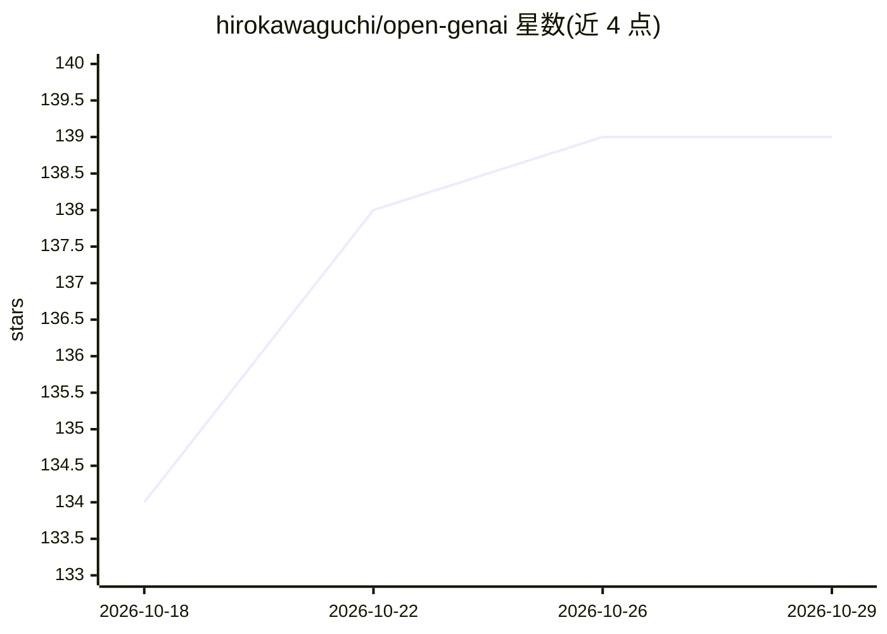

# hirokawaguchi/open-genai

⭐ 139 · TypeScript · MIT · 推送 2026-10-27 · [GitHub](https://github.com/hirokawaguchi/open-genai) · 个人维护

**将日本政府 AI「源内」完全本地化部署的非官方项目**

非官方项目：将日本数字厅开源的政府 AI「源内（GENAI）」改造为完全本地运行——SAML 认证改用 Keycloak、LLM 调用改走 OpenAI 互换 API（默认 Ollama）、聊天历史用 SQLite、RAG 用 Qdrant、转录用 faster-whisper、图像生成用本地 Stable Diffusion。面向自治体/閉域（LGWAN）運用扩展：棟+チーム多租户、审计日志、禁止语/个人信息检测、模型利用控制、各类行政文档 AI 应用（exApp）。通过 Docker Compose 提供开发/生产 TLS/閉域验证三种配置，不含官方 genai-ai-api。

## 筛选速览

| 维度 | 判定 | 备注 |
|---|---|---|
| AI 角色 | `ai-native` | 本体是模型或模型工具 |
| 许可风险 | `permissive` | MIT |
| 部署形态 | `self-host` | docker 或自建部署 |
| 模型依赖 | local-ok | 支持本地模型 |
| 硬件要求 | — | 无带数字的原话,不猜 |
| 安装摩擦 | `low` | 无编译、无系统依赖或容器化 |
| 成熟度 | — | 结构信号不足 |

## 能力要点

- 云托管服务全部替换为开源/本地组件（Keycloak/Qdrant/SQLite/SeaweedFS/faster-whisper）
- 任意 OpenAI 互换服务器可切换（默认 Ollama /v1）
- 自治体治理功能：审计日志 3 年保持、禁止语・PII 检知、棟+チーム多租户
- 大量行政实務 exApp：RAG、日程调整、Markdown 文档生成、申请手续等

## 适用场景

- 政府机构在閉域网/LGWAN 内自建源内系统
- 用本地 LLM 替代云端 Bedrock 运行政府 AI 应用
- 需要审计与数据删除治理的团队 AI 部署

## 场景标签

`RAG` `图像生成` `语音识别` `聊天机器人` · 领域:对话与助手

## 证据(README 行号)

> L10: デジタル庁がオープンソースで公開したガバメント AI「源内（GENAI）」を、
> L31: - LLM 呼び出しを **OpenAI 互換 API** 経由で行う（既定は Ollama の `/v1`。vLLM / LM Studio / OpenAI など任意の OpenAI 互換サーバに切替可）
> L64: 1. **自治体実務を想定した機能** — 監査ログ（3 年以上保持）、利用者 CSV 一括管理、モデル利用制御、禁止語／個人情報検知（添付警告・ナレッジラベル、任意の GiNZA NER）、プロンプトテンプレート、ノートブック（

## 星数曲线

2026-10-18 134 → 2026-10-29 139（+5）

---
*卡片 v1 · prompt 1.4 · 生成 2026-10-22 · 置信度 high · 依据 README sha `137ff920b1ee` · [字段定义](../../DATASET.md)*
