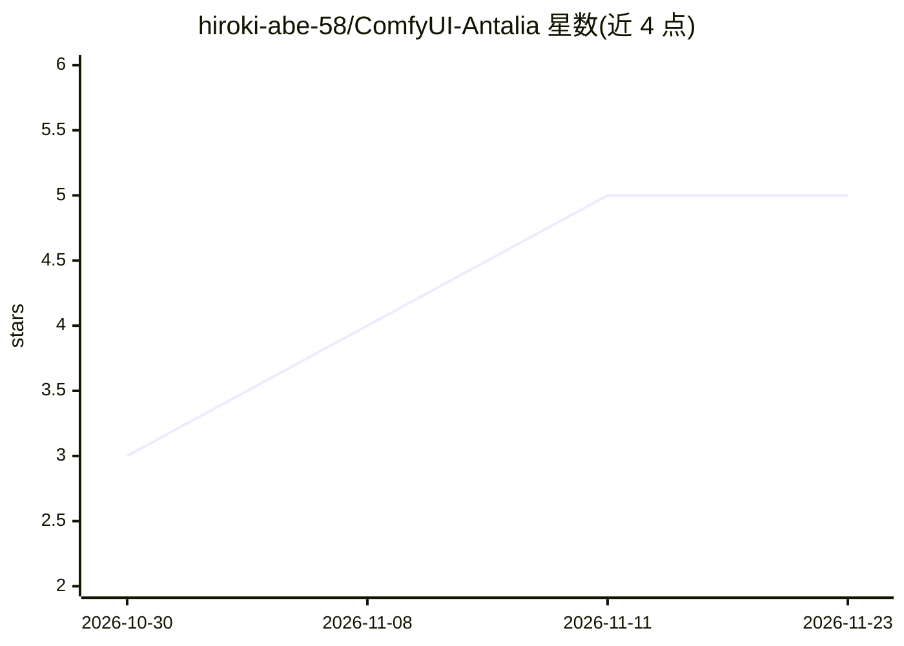

# hiroki-abe-58/ComfyUI-Antalia

⭐ 5 · Python · MIT · 推送 2026-10-19 · [GitHub](https://github.com/hiroki-abe-58/ComfyUI-Antalia) · 个人维护

**在 ComfyUI 中调用土耳其语 TTS 模型 Antalia-2 Mini 的节点包**

非官方的 ComfyUI 自定义节点包，提供模型加载与文本转语音两个节点：调用官方 antalia-mini 包（Apache-2.0）生成单一合成男声、48 kHz 的土耳其语语音，数字、日期、网址等由包内归一化器转为读法。README 给出 CPU 与 RTX 5090 的耗时数据、七项与官方包逐样本一致性的验证结果，并注明语音质量本身未检验、Apple MPS 与 CI 之外的 Linux/macOS 未验证。安装需 ComfyUI v0.38.0+、Python 3.10+，克隆仓库并下载模型权重。

## 筛选速览

| 维度 | 判定 | 备注 |
|---|---|---|
| AI 角色 | `ai-native` | 本体是模型或模型工具 |
| 许可风险 | `permissive` | MIT |
| 部署形态 | `library` | 以包/库形式分发 |
| 模型依赖 | — | README 未给出锁定关系 |
| 硬件要求 | — | 无带数字的原话,不猜 |
| 安装摩擦 | `medium` | 含编译或系统依赖之一 |
| 成熟度 | — | 结构信号不足 |

## 能力要点

- 提供 Loader 与 Speak 两个 ComfyUI 节点，文本转单声道 AUDIO 输出
- 文本归一化：数字、日期、时间、金额、网址、英文词转为土耳其语读法
- 支持 fp32/fp16 权重、48/24/16/8 kHz 采样率与输出 EQ/去嘶声
- 验证与官方包输出逐样本一致，模型权重固定版本并校验 SHA-256

## 适用场景

- 在 ComfyUI 工作流中为土耳其语文本生成语音
- 生成电话频段（8 kHz）语音输出
- 把生成的语音接入视频工作流或保存为 FLAC

## 场景标签

`语音合成` · 领域:内容生成

## 证据(README 行号)

> L4: Apache-2.0): a small model (7.6M parameters, 46 MB for both weight files) with one synthetic male voice, 48 kHz outp
> L6: web addresses and English or brand words are turned into their spoken form by the package's own normaliser. The node
> L18: |**Antalia-2 Mini Loader**|Loads the model from `models/antalia/<name>/` (fp32 or fp16 weights) onto ComfyUI's GPU 

## 星数曲线

2026-10-30 3 → 2026-11-23 5（+2）

---
*卡片 v1 · prompt 1.4 · 生成 2026-11-22 · 置信度 high · 依据 README sha `49dc106ccdcc` · [字段定义](../../DATASET.md)*
