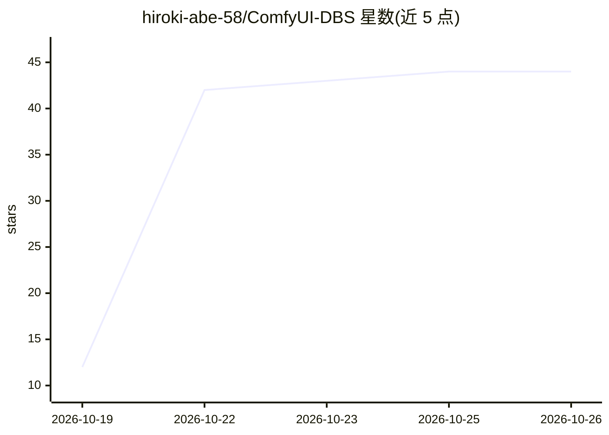

# hiroki-abe-58/ComfyUI-DBS

⭐ 44 · Python · MIT · 推送 2026-10-19 · [GitHub](https://github.com/hiroki-abe-58/ComfyUI-DBS) · 个人维护

**ComfyUI 节点包：用官方 DBS 模型把音轨分成音乐/音效/人声**

将 Dynamic Band Splitting (DBS) 官方模型（DBS-TIGER-DnR / DBS-BSRNN-DnR，1.0M 与 4.7M 参数）封装为 ComfyUI 节点的非官方集成包：AUDIO 输入输出 music、sfx、speech 三路分轨及 JSON 报告，可用于去对白、提取对白供配音/转写或混音再平衡。模型在 CUDA 或 CPU 上运行，三轨相加可还原输入（约 1e-6）。代码内嵌官方实现、运行时不联网下载，经与官方包逐字节对比验证（CPU 6/6 一致）。限制：模型训练于 DnR v2 英语影视类数据，唱歌声可能归入 music；未评估分离质量本身。

## 筛选速览

| 维度 | 判定 | 备注 |
|---|---|---|
| AI 角色 | `ai-native` | 本体是模型或模型工具 |
| 许可风险 | `permissive` | MIT |
| 部署形态 | `library` | 以包/库形式分发 |
| 模型依赖 | — | README 未给出锁定关系 |
| 硬件要求 | — | 无带数字的原话,不猜 |
| 安装摩擦 | `medium` | 含编译或系统依赖之一 |
| 成熟度 | — | 结构信号不足 |

## 能力要点

- DBS Loader 与 DBS Separate 节点，输出 music/sfx/speech 三轨加 JSON 报告
- 内嵌官方 DBS 代码，运行时不下载任何内容
- CPU 上与官方包输出逐字节一致（6/6 案例），CUDA 下需确定性算法才一致
- 提供分离、去对白、视频去对白三个现成 workflow

## 适用场景

- 去掉视频对白、保留音乐与音效
- 提取对白用于配音或转写
- 在 ComfyUI 流水线中对音轨做三路分离

## 场景标签

 · 领域:音频源分离/创作工具

## 证据(README 行号)

> L3: Separate a soundtrack into **music**, **sound effects** and **speech** inside ComfyUI, with the official **Dynamic B
> L24: |**DBS Separate (music / sfx / speech)**|`AUDIO` in → `music`, `sfx`, `speech` (`AUDIO`) and a JSON report|

## 星数曲线

2026-10-19 12 → 2026-10-26 44（+32）

---
*卡片 v1 · prompt 1.4 · 生成 2026-10-25 · 置信度 mid · 依据 README sha `8e064b787aad` · [字段定义](../../DATASET.md)*
