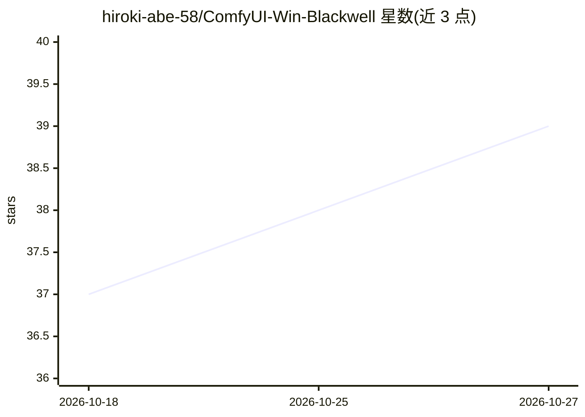

# hiroki-abe-58/ComfyUI-Win-Blackwell

⭐ 39 · PowerShell · MIT · 推送 2026-10-22 · [GitHub](https://github.com/hiroki-abe-58/ComfyUI-Win-Blackwell) · 个人维护 · 中文 README

**Windows 原生 ComfyUI 安装包：适配 RTX 50 系 Blackwell GPU**

面向 GeForce RTX 5090/5080/5070（Blackwell，sm_120）用户的 ComfyUI 一键安装与配置仓库。因 PyTorch 稳定版尚不支持该架构，此方案固定 PyTorch nightly cu130、Python 3.13、triton-windows 组合，排除 xformers，全程无需 WSL2 或 Docker。提供 setup.bat 一键安装、run.bat 启动、verify_env.py 校验环境，收录 28 个在 RTX 5090 上验证过的自定义节点（含视频/音乐生成）与 5 条图生视频工作流，并文档化 Windows 路径分隔符等修复项与 5 条必须遵守的环境规则。

## 筛选速览

| 维度 | 判定 | 备注 |
|---|---|---|
| AI 角色 | `ai-ecosystem` | LLM/agent 周边工具 |
| 许可风险 | `permissive` | MIT |
| 部署形态 | `library` | 以包/库形式分发 |
| 模型依赖 | — | README 未给出锁定关系 |
| 硬件要求 | — | 无带数字的原话,不猜 |
| 安装摩擦 | `medium` | 含编译或系统依赖之一 |
| 成熟度 | `idea` | |

## 能力要点

- setup.bat 一键安装 + run.bat 启动，Windows 原生运行无需 WSL2/Docker
- 固定 PyTorch nightly cu130 + triton-windows 组合支持 sm_120
- 28 个自定义节点与 5 条图生视频工作流在 RTX 5090 上验证
- 附带工作流路径修复脚本与 PyTorch 版本校验/重装命令

## 适用场景

- 我在 RTX 5090/5080/5070 上装 ComfyUI 跑视频和图片生成
- 需要 Windows 原生环境且不想折腾 WSL2 或 Docker
- 按已验证的节点清单和工作流直接上手图生视频

## 场景标签

`图像生成` `视频生成` · 领域:内容生成

## 证据(README 行号)

> L3: **The first fully documented, Windows-native ComfyUI setup for NVIDIA GeForce RTX 5090/5080/5070 (Blackwell architec
> L9: RTX 50-series GPUs (Blackwell, Compute Capability sm_120) are **not supported by PyTorch stable releases** as of ear
> L63: 1. Download or clone this repository

## 星数曲线

2026-10-18 37 → 2026-10-27 39（+2）

---
*卡片 v1 · prompt 1.4 · 生成 2026-10-25 · 置信度 mid · 依据 README sha `42059805ede2` · [字段定义](../../DATASET.md)*
