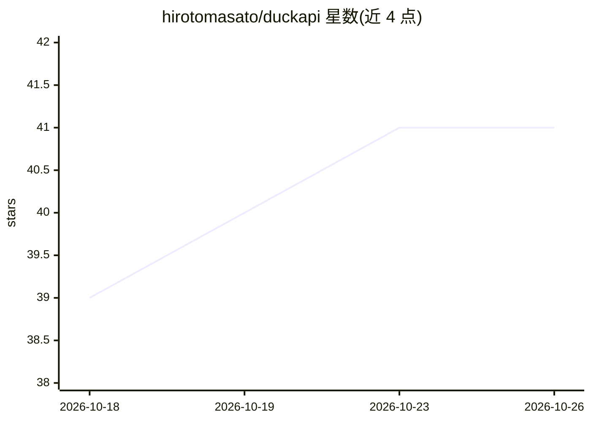

# hirotomasato/duckapi

⭐ 41 · Python · MIT · 推送 2026-09-29 · [GitHub](https://github.com/hirotomasato/duckapi) · 个人维护

**把 Duck.ai 网页封装成 OpenAI/Anthropic 兼容 API 的自托管代理**

非官方项目：用 Playwright 驱动本机已安装的 Chrome 打开 Duck.ai 网页，在输入框键入提示词并读取页面回答，再以 /v1/chat/completions、/v1/messages、/v1/images/generations 等 OpenAI/Anthropic 兼容端点对外提供流式聊天与图片生成，附 Web 仪表盘。会话复用仅键入增量、挑战感知预热与代理池轮换用于应对封禁。README 明示违反 Duck.ai 服务条款可能导致永久 IP 封禁的风险由使用者承担。安装为 git clone 后运行 run.py，自动建虚拟环境并启动服务。

## 筛选速览

| 维度 | 判定 | 备注 |
|---|---|---|
| AI 角色 | `ai-ecosystem` | LLM/agent 周边工具 |
| 许可风险 | `permissive` | MIT |
| 部署形态 | `None` |  |
| 模型依赖 | — | README 未给出锁定关系 |
| 硬件要求 | — | 无带数字的原话,不猜 |
| 安装摩擦 | `low` | 无编译、无系统依赖或容器化 |
| 成熟度 | — | 结构信号不足 |

## 能力要点

- OpenAI 兼容 /v1/chat/completions 与 Anthropic 兼容 /v1/messages、/v1/responses
- 经 Duck.ai 原生 GenerateImage 工具生成图片（n 上限 4，每张 15–20s）
- 会话复用仅键入增量（实测约 3s/轮）与挑战感知预热（首 token 约 5.5s）
- 代理池轮换、凭证脱敏与 Web 仪表盘（状态/日志/Playground）

## 适用场景

- 让任意 OpenAI 兼容客户端或 Claude Code 通过 base URL 调用 Duck.ai
- 自托管一个可观测的聊天与图片生成 API 并在仪表盘中调试
- 在可承受封禁风险的出口 IP 上轮换代理池维持可用性

## 场景标签

`模型网关` · 领域:Agent 开发

## 证据(README 行号)

> L12: Duck.ai has no public API. This project opens the real site in a real Chrome
> L15: `/v1/chat/completions` endpoint. Any OpenAI-compatible client (or Claude Code,

## 星数曲线

2026-10-18 39 → 2026-10-26 41（+2）

---
*卡片 v1 · prompt 1.4 · 生成 2026-10-25 · 置信度 high · 依据 README sha `b4f410c2e2f6` · [字段定义](../../DATASET.md)*
