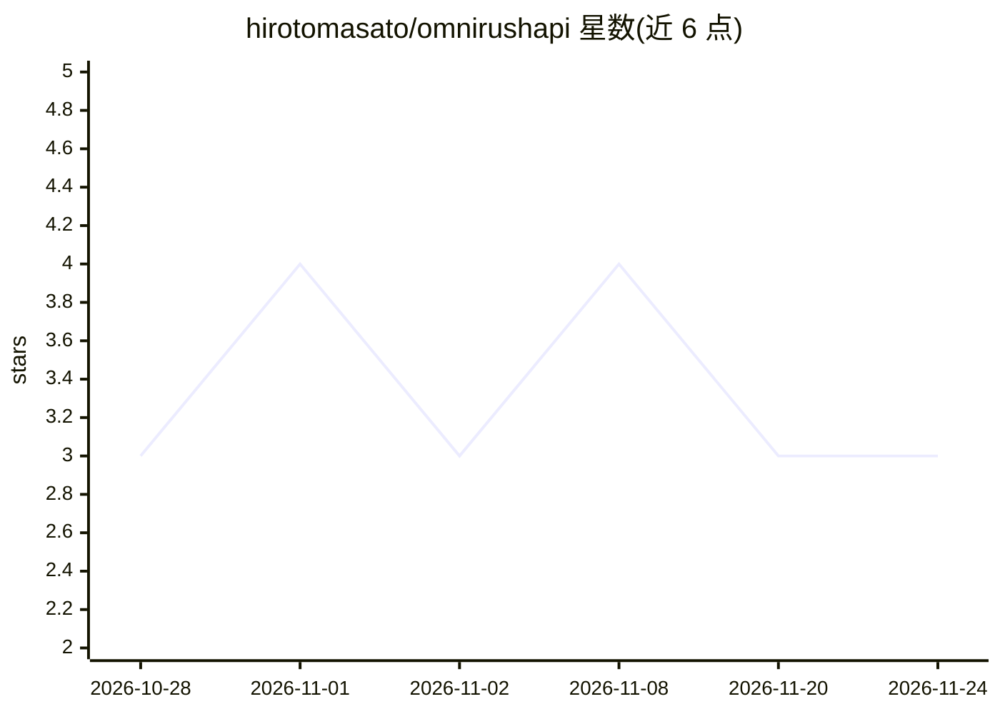

# hirotomasato/omnirushapi

⭐ 3 · TypeScript · MIT · 推送 2026-10-26 · [GitHub](https://github.com/hirotomasato/omnirushapi) · 个人维护

**自托管 LLM 网关：多上游账号聚合为单一端点，轮询故障转移**

自托管网关，对外提供 OpenAI 与 Anthropic 兼容端点，对内连接多个上游账号：三种方言（OpenAI chat completions、OpenAI responses、Anthropic messages）双向翻译，支持流式与工具调用；按优先级/权重轮询或最少使用路由，上游拒绝时冷却并重试其他账号；支持 device-flow 登录与令牌自动续期；配六页服务器渲染控制台、CLI 与 admin API；存储用单文件 SQLite，经 curl 走代理。需 Node 22+，git clone 源码运行。

## 筛选速览

| 维度 | 判定 | 备注 |
|---|---|---|
| AI 角色 | `ai-ecosystem` | LLM/agent 周边工具 |
| 许可风险 | `permissive` | MIT |
| 部署形态 | `self-host` | docker 或自建部署 |
| 模型依赖 | — | README 未给出锁定关系 |
| 硬件要求 | — | 无带数字的原话,不猜 |
| 安装摩擦 | `low` | 无编译、无系统依赖或容器化 |
| 成熟度 | — | 结构信号不足 |

## 能力要点

- 三种 API 方言作为客户端与上游格式，双向翻译含流式与工具调用
- 轮询/最少使用路由，故障账号冷却停放并重试其他账号
- device-flow 凭证续期、并发竞态下每账号一次刷新
- 控制台/CLI/admin API 三种管理入口，SQLite 单文件存储

## 适用场景

- 把多个上游账号聚合成一个 base URL 供团队客户端调用
- 多账号间轮询以绕开单 key 的速率限制
- 企业 TLS 代理环境下经 curl 保持上游连接
- 查看每账号用量与供应商侧配额余量

## 场景标签

`模型网关` · 领域:Agent 开发

## 证据(README 行号)

> L5: **One endpoint in front of many upstream accounts.** A self-hosted gateway that speaks the
> L5: **One endpoint in front of many upstream accounts.** A self-hosted gateway that speaks the

## 星数曲线

2026-10-28 3 → 2026-11-24 3（+0）

---
*卡片 v1 · prompt 1.4 · 生成 2026-11-21 · 置信度 mid · 依据 README sha `386e0dc60ee9` · [字段定义](../../DATASET.md)*
