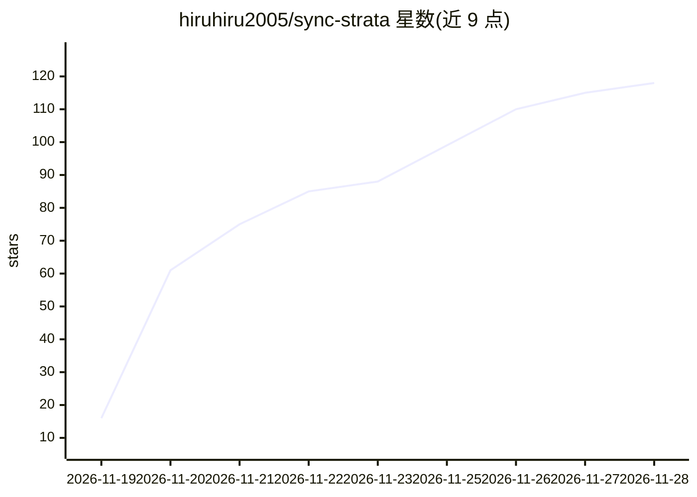

# hiruhiru2005/sync-strata

⭐ 118 · JavaScript · MIT · 推送 2026-11-25 · [GitHub](https://github.com/hiruhiru2005/sync-strata) · 个人维护

**在家庭单机上一键运行 Qwen3.8-Flash-Next 量化模型的应用**

面向 Windows/Linux 家庭 PC 用户：运行 125B MoE 模型 Qwen3.8-Flash-Next 的再量化版本（Sync-XS/S/M），引擎为 Strata 的 fork。安装器检测 GPU 并下载匹配引擎，应用按内存自动选择模型档位；附带聊天应用 dsh，可通过桌面应用、手机（同 Wi-Fi 扫码或 Tailscale）、命令行及 OpenAI/Anthropic 兼容 API 使用。README 标注为实验性，模型与引擎格式不兼容上游 Strata 或 llama.cpp。

## 筛选速览

| 维度 | 判定 | 备注 |
|---|---|---|
| AI 角色 | `ai-native` | 本体是模型或模型工具 |
| 许可风险 | `permissive` | MIT |
| 部署形态 | `desktop` | 安装包/桌面程序 |
| 模型依赖 | — | README 未给出锁定关系 |
| 硬件要求 | — | 无带数字的原话,不猜 |
| 安装摩擦 | `medium` | 含编译或系统依赖之一 |
| 成熟度 | `idea` | |

## 能力要点

- 提供 Sync-XS/S/M 三档量化模型，按内存档位自动推荐
- 附 dsh 聊天应用，支持桌面、手机扫码、CLI 与 API 四种入口
- 提供 OpenAI 兼容 /v1 与 Anthropic 兼容 /v1/messages 端点
- 内存挤压、会话状态保存、上下文与 KV 量化自动配置

## 适用场景

- 在单张消费级 GPU 的家用 PC 上运行大参数本地模型
- 通过手机在局域网或 Tailscale 下与本地模型聊天
- 以 OpenAI 兼容 API 接入其他程序调用本地模型

## 场景标签

`推理引擎` `模型量化` `聊天机器人` · 领域:对话与助手

## 证据(README 行号)

> L5: Sync-Strata runs Qwen3.8-Flash-Next (a 125B MoE model) on a single home PC.
> L6: The engine is a fork of Strata, and the models, **Sync-XS, Sync-S and Sync-M**, are re-quantized to run faster than 
> L7: A chat app (dsh) comes with the engine, and you can use it from the desktop app, your phone, the command line or an 

## 星数曲线

2026-11-19 16 → 2026-11-28 118（+102）

---
*卡片 v1 · prompt 1.4 · 生成 2026-11-28 · 置信度 high · 依据 README sha `e4f39f459da3` · [字段定义](../../DATASET.md)*
