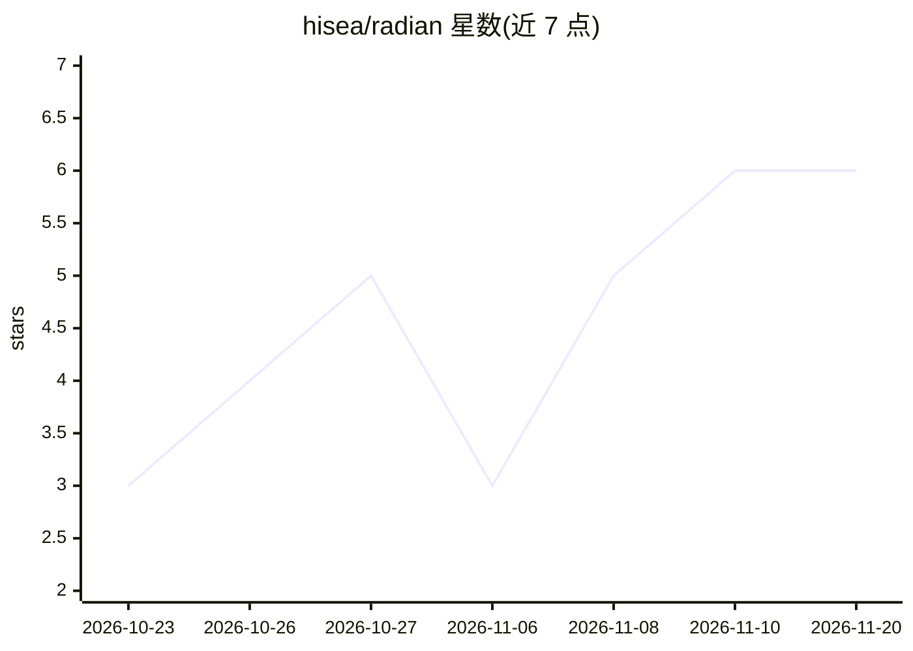

# hisea/radian

⭐ 6 · Rust · Apache-2.0 · 推送 2026-11-05 · [GitHub](https://github.com/hisea/radian) · [官网](https://getrad.dev) · 个人维护 · 中文 README

**单 Rust 二进制的终端编码 Agent，带任务编排器 arc**

以单个 Rust 二进制发布的编码 Agent：提供全屏 TUI 与 headless（exec）两种运行模式，会话以 JSONL 日志保存，可恢复、分叉或只读观察。接入 OpenAI 兼容 Chat Completions 与 Anthropic Messages API，内置文件/搜索/shell 工具、MCP stdio 服务器、skills、memory 与一次性 subagent，并读取已有的 AGENTS.md/CLAUDE.md 与 Claude/Codex 风格 hooks。权限分层含可选 OS 沙箱（macOS seatbelt / Linux bubblewrap）。附带的 arc 编排器将请求拆为任务文件，每个任务由独立 headless worker 在独立 git worktree 分支执行，经可配置 gate（fmt/clippy/tests 等）后合并。面向在终端与 git 仓库中工作的开发者。

## 筛选速览

| 维度 | 判定 | 备注 |
|---|---|---|
| AI 角色 | `ai-native` | 本体是模型或模型工具 |
| 许可风险 | `permissive` | Apache-2.0 |
| 部署形态 | `desktop` | 安装包/桌面程序 |
| 模型依赖 | locked-api |  |
| 硬件要求 | — | 无带数字的原话,不猜 |
| 安装摩擦 | `low` | 无编译、无系统依赖或容器化 |
| 成熟度 | — | 结构信号不足 |

## 能力要点

- 单二进制提供 TUI 与 headless 两种模式，JSONL 会话可恢复/分叉/attach
- arc 编排器：lead 写计划、任务在独立 git worktree 执行、过 gate 才合并
- 权限分层：默认 full，--profile workspace 启用 seatbelt/bubblewrap 沙箱
- 支持 MCP、skills、memory，并兼容 AGENTS.md/CLAUDE.md 与 Claude/Codex hooks

## 适用场景

- 在终端里让 Agent 完成单个编码任务并获取结构化 JSONL 步骤输出
- 把一批待办拆成多个并行任务，各自分支开发、过测试 gate 后合并
- 用沙箱 profile 限制 Agent 对工作区外的写入

## 场景标签

`编码 Agent` · 领域:编码与开发

## 证据(README 行号)

> L12: radian is a fast, efficient coding agent in one Rust binary.
> L22: - Providers: OpenAI-compatible Chat Completions and the Anthropic Messages API. Tools: built-in file, search, shell
> L44: arc (`radian arc`) is a plan and task orchestrator.

## 星数曲线

2026-10-23 3 → 2026-11-20 6（+3）

---
*卡片 v1 · prompt 1.4 · 生成 2026-11-20 · 置信度 high · 依据 README sha `d699ec7f8d40` · [字段定义](../../DATASET.md)*
