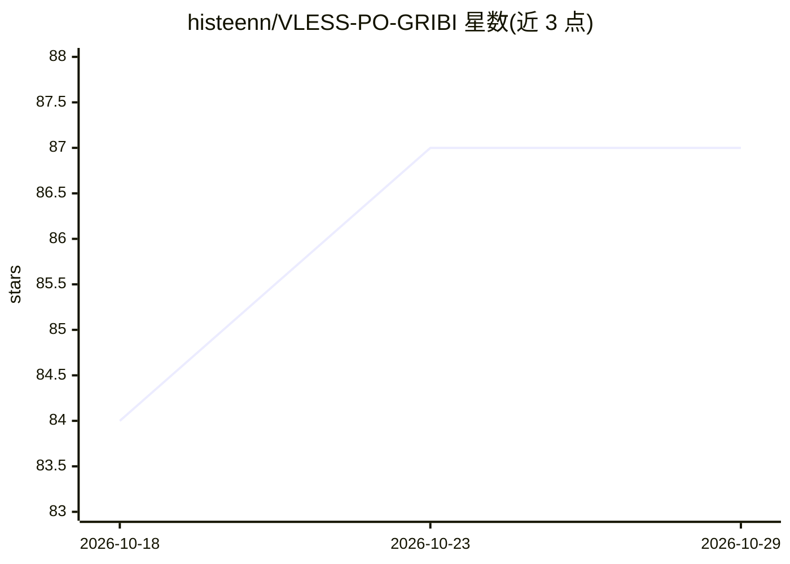

# histeenn/VLESS-PO-GRIBI

⭐ 87 · Python · MIT · 推送 2026-10-28 · [GitHub](https://github.com/histeenn/VLESS-PO-GRIBI) · [官网](https://t.me/histeenn) · 个人维护

**每 3 小时自动聚合校验的免费 VPN 订阅链接集合**

通过 GitHub Actions 每 3 小时从 25 个公开来源自动收集并校验免费 VPN 服务器（约 4400+），以 25 个订阅文件形式发布，供 VLESS/Shadowsocks 等协议客户端导入。README 提供 Android（v2rayNG）、iOS（V2Box）、Windows（Throne）、Linux（NekoRay）四个平台的订阅导入与连接步骤说明。README 提示 SS 协议可能因限速暂不可用；项目自称仅用于教育与技术研究，并声明不承担使用责任。

## 筛选速览

| 维度 | 判定 | 备注 |
|---|---|---|
| AI 角色 | `ai-knowledge` | 知识聚合/清单类 |
| 许可风险 | `permissive` | MIT |
| 部署形态 | `None` |  |
| 模型依赖 | — | README 未给出锁定关系 |
| 硬件要求 | — | 无带数字的原话,不猜 |
| 安装摩擦 | `low` | 无编译、无系统依赖或容器化 |
| 成熟度 | — | 结构信号不足 |

## 能力要点

- 每 3 小时经 GitHub Actions 自动收集并校验 25 个来源的服务器
- 发布 25 个可直接复制的订阅链接文件
- 覆盖 Android/iOS/Windows/Linux 四平台的客户端导入教程

## 适用场景

- 在 v2rayNG/V2Box/Throne/NekoRay 等客户端中导入免费订阅
- 获取定期更新且经过校验的可用服务器列表
- 添加多个订阅作为备用连接选项

## 场景标签

 · 领域:网络/VPN 配置聚合

## 证据(README 行号)

> L20: Этот проект автоматически собирает и проверяет **бесплатные VPN-серверы** из открытых источников. Обновление происх
> L24: - 🚀 **Всего серверов**: ~4400+

## 星数曲线

2026-10-18 84 → 2026-10-29 87（+3）

---
*卡片 v1 · prompt 1.4 · 生成 2026-10-23 · 置信度 high · 依据 README sha `d5a4bf63f637` · [字段定义](../../DATASET.md)*
