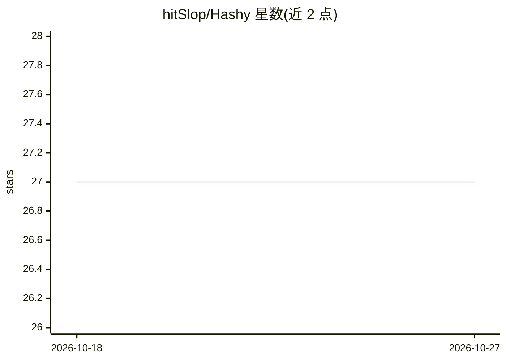

# hitSlop/Hashy

⭐ 27 · Swift · MIT · 推送 2026-02-23 · [GitHub](https://github.com/hitSlop/Hashy) · [官网](https://hashy.ink) · 个人维护

**macOS/iOS 原生 Markdown 编辑器，内置 AI 聊天与 iCloud 同步**

SwiftUI 原生应用，面向以 Markdown 记笔记的开发者：笔记为带 YAML frontmatter 的普通 .md 文件，经 iCloud Drive 跨设备同步并含冲突检测。AI 部分内置聊天与 11 个工具，可让模型直接创建、编辑、搜索、整理笔记；支持接入 OpenRouter（默认）、OpenAI、Anthropic API key，可选 20+ 模型，按量付费无订阅。另自动安装 Claude Code 技能文件到笔记库。要求 macOS 14+/iOS 17+，从 Xcode 源码构建。

## 筛选速览

| 维度 | 判定 | 备注 |
|---|---|---|
| AI 角色 | `ai-enhanced` | 去掉 AI 部分产品仍成立 |
| 许可风险 | `permissive` | MIT |
| 部署形态 | `None` |  |
| 模型依赖 | locked-api |  |
| 硬件要求 | — | 无带数字的原话,不猜 |
| 安装摩擦 | `low` | 无编译、无系统依赖或容器化 |
| 成熟度 | — | 结构信号不足 |

## 能力要点

- 原生 SwiftUI 构建，非 Electron/Web View
- AI 通过 11 个工具直接操作笔记（创建/编辑/搜索/整理）
- OpenRouter/OpenAI/Anthropic 三通道，20+ 模型，自带 key 按量付费
- 自动安装 Claude Code 技能（SKILL.md）到笔记库

## 适用场景

- 在 Apple 设备间同步管理纯 Markdown 笔记
- 让 AI 直接代为创建、编辑和搜索我的笔记
- 用自己的 API key 按量付费使用多种模型

## 场景标签

`知识库管理` · 领域:知识与检索

## 证据(README 行号)

> L20: Hashy is a native macOS and iOS markdown editor with built-in AI chat, iCloud sync, and Claude Code integration. Yo
> L22: Ask the AI to create, organize, search, and edit your notes using 11 specialized tools. Bring your own OpenRouter, 

## 星数曲线

2026-10-18 27 → 2026-10-27 27（+0）

---
*卡片 v1 · prompt 1.4 · 生成 2026-10-26 · 置信度 high · 依据 README sha `ecad7fd45851` · [字段定义](../../DATASET.md)*
