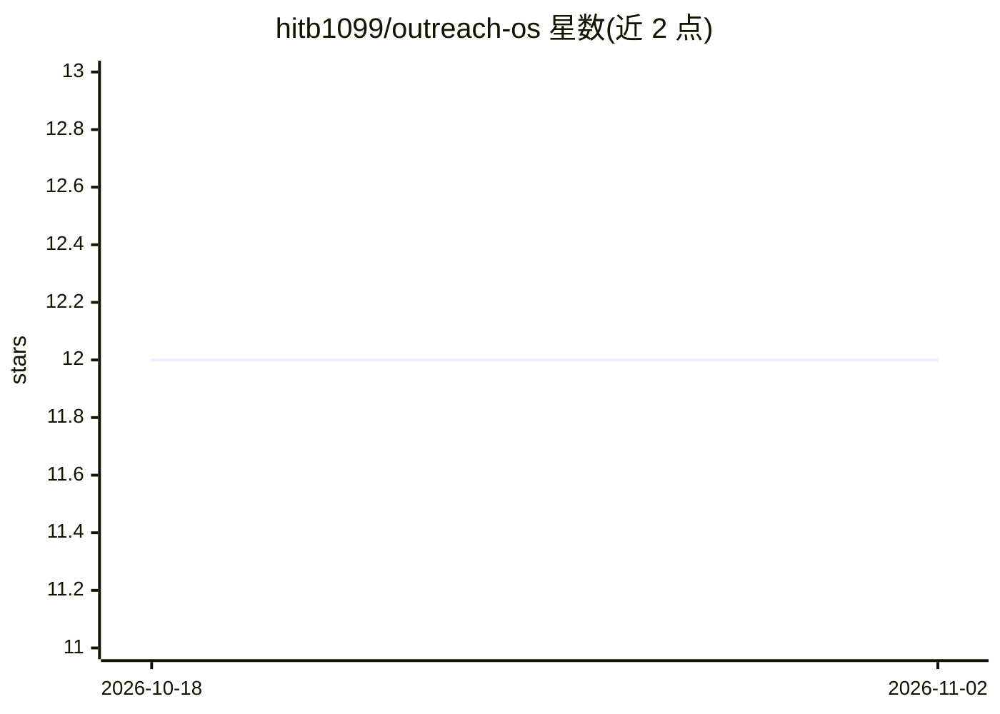

# hitb1099/outreach-os

⭐ 12 · JavaScript · MIT · 推送 2026-07-20 · [GitHub](https://github.com/hitb1099/outreach-os) · [官网](https://github.com/hitb1099/outreach-os) · 个人维护

**自托管 B2B 获客外联系统：AI 评分、写冷邮件并自动跟进**

由三个 N8N 工作流组成的生产就绪外联流水线：通过 Google Places API 检索线索，按评分（Google 评分、评论量、有无网站等 6 维度，0-100 分）分出 HOT/NURTURE 存入 Google Sheets；用 GLM-4（Z.ai 免费层）或 GPT-4o-mini 生成行业感知的个性化冷邮件，Pollinations.ai 生成横幅图，经 Gmail 发送；每日定时检查回复并对 3 天未回复者自动跟进。面向不愿付费订阅商业外联工具的独立开发者/小团队，提供 npm CLI 一键安装工作流 JSON，需自备多项 API 凭据。

## 筛选速览

| 维度 | 判定 | 备注 |
|---|---|---|
| AI 角色 | `ai-native` | 本体是模型或模型工具 |
| 许可风险 | `permissive` | MIT |
| 部署形态 | `library` | 以包/库形式分发 |
| 模型依赖 | — | README 未给出锁定关系 |
| 硬件要求 | — | 无带数字的原话,不猜 |
| 安装摩擦 | `low` | 无编译、无系统依赖或容器化 |
| 成熟度 | — | 结构信号不足 |

## 能力要点

- Google Places 线索检索 + 6 维度 100 分制评分
- GLM-4 / GPT-4o-mini 双 LLM 支持的行业感知邮件生成
- Pollinations.ai 按公司生成横幅图
- Gmail 回复追踪与 3 天无回复自动跟进，状态全程记入 Google Sheets

## 适用场景

- 本地服务商（如餐厅营销代理）自动获取并筛选每日新线索
- 独立创始人按 HOT 线索过滤定向发送个性化冷邮件
- 多客户代理为每个客户克隆独立工作流并自动跟进

## 场景标签

`工作流自动化` `AI 写作` · 领域:效率与自动化

## 证据(README 行号)

> L7: Find leads → Score them → Send AI-personalized cold emails → Track replies → Auto follow-up
> L82: |2|**AI Email Automation**|Detects industry, generates brand personality context, creates a Pollinations banner, wr
> L91: - **Multi-LLM support** — OpenAI GPT-4o-mini + Z.ai GLM-4.7-flash (free tier)

## 星数曲线

2026-10-18 12 → 2026-11-02 12（+0）

---
*卡片 v1 · prompt 1.4 · 生成 2026-11-01 · 置信度 high · 依据 README sha `0ef93b664b82` · [字段定义](../../DATASET.md)*
