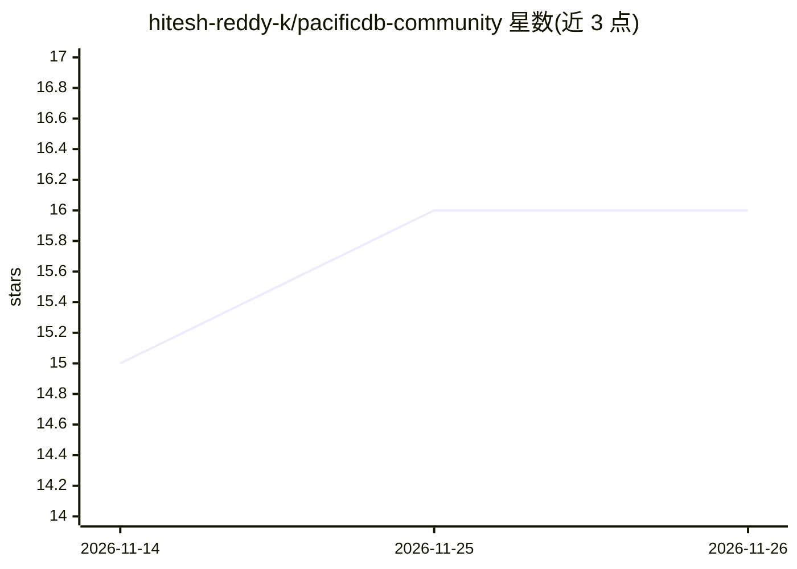

# hitesh-reddy-k/pacificdb-community

⭐ 16 · C++ · AGPL-3.0 · 推送 2026-11-14 · [GitHub](https://github.com/hitesh-reddy-k/pacificdb-community) · [官网](https://pacificdb.in/) · 组织维护

**C++17 自托管多模数据库：JSON 文档、向量检索与媒体存储**

PacificDB Community 是自托管的多模型数据库引擎，用 C++17 编写，将 JSON 文档记录、向量嵌入（稠密/稀疏/命名向量，精确 cosine/L2/dot 相似度搜索，可选独立 HNSW 与混合检索）与媒体文件（支持断点续传、校验和的图像/音视频存储）整合在同一系统，持久层采用 WAL/LSM，含快照、备份恢复与 RF3 复制。面向探索 AI/RAG 应用或通用数据负载的开发者。提供桌面 Workbench 安装包、原生与 npm CLI、Node.js/Python/Java 客户端；严格 ANN 在索引维护期间可能报告不可用，分布式分片向量搜索不在支持范围内。

## 筛选速览

| 维度 | 判定 | 备注 |
|---|---|---|
| AI 角色 | `ai-ecosystem` | LLM/agent 周边工具 |
| 许可风险 | `viral` | AGPL-3.0 |
| 部署形态 | `desktop` | 安装包/桌面程序 |
| 模型依赖 | — | README 未给出锁定关系 |
| 硬件要求 | — | 无带数字的原话,不猜 |
| 安装摩擦 | `medium` | 含编译或系统依赖之一 |
| 成熟度 | — | 结构信号不足 |

## 能力要点

- JSON 文档 CRUD、二级索引与聚合，外加稠密/稀疏/命名向量记录
- 精确 cosine/L2/dot 搜索与可选独立 HNSW、混合检索
- WAL/LSM 持久化、快照、备份恢复与 RF3 复制
- 桌面 Workbench、原生/npm CLI 与 Node.js、Python、Java 客户端

## 适用场景

- 本地运行一个同时存 JSON 文档与向量嵌入的数据库做 RAG 评估
- 在一个系统中统一存储结构化记录、向量与媒体文件
- 自托管部署并配置 TLS、认证与租户访问控制

## 场景标签

`向量数据库` · 领域:知识与检索

## 证据(README 行号)

> L7: PacificDB is a multi-model database engine built in C++17. It brings document
> L11: For developers exploring AI and RAG applications or general-purpose data

## 星数曲线

2026-11-14 15 → 2026-11-26 16（+1）

---
*卡片 v1 · prompt 1.4 · 生成 2026-11-18 · 置信度 high · 依据 README sha `5fe05c8d1f87` · [字段定义](../../DATASET.md)*
