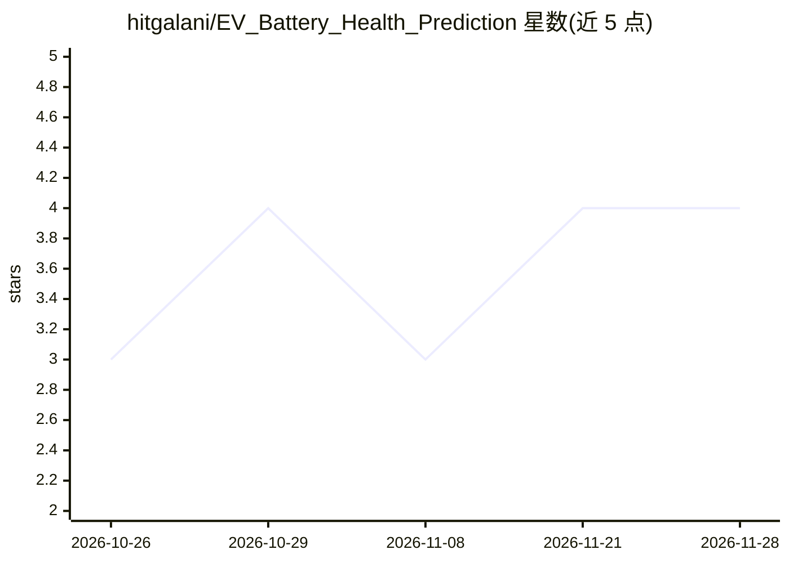

# hitgalani/EV_Battery_Health_Prediction

⭐ 4 · HTML · 推送 2026-11-25 · [GitHub](https://github.com/hitgalani/EV_Battery_Health_Prediction) · 组织维护

**学生学习项目：用线性回归预测电动汽车电池健康度（SoH）**

两名 BCA（AI）学生的学期学习项目，遵循完整 ML 生命周期（加载→清洗→探索→划分→训练→测试→预测）：基于 Kaggle 合成数据集（10,000 行 × 13 列），用简单/多元线性回归预测 SoH 百分比，用逻辑回归预测 Healthy/Not Healthy 标签，并报告 MAE、R²、混淆矩阵与五折交叉验证结果。README 明确声明仅为学习用途，数据为合成生成，不可用于真实车辆决策；部署与实时监控尚在 Semester 4 计划中。

## 筛选速览

| 维度 | 判定 | 备注 |
|---|---|---|
| AI 角色 | `ai-native` | 本体是模型或模型工具 |
| 许可风险 | `none` | — |
| 部署形态 | `desktop` | 安装包/桌面程序 |
| 模型依赖 | — | README 未给出锁定关系 |
| 硬件要求 | — | 无带数字的原话,不猜 |
| 安装摩擦 | `low` | 无编译、无系统依赖或容器化 |
| 成熟度 | `idea` | |

## 能力要点

- 简单/多元线性回归预测 SoH(%)，逻辑回归预测健康状态标签
- 报告 MAE、R²、混淆矩阵与五折交叉验证结果
- 附 Sweetviz 自动 EDA 报告与离线学习网站
- 明确标注数据为合成数据，不可用于真实电池决策

## 适用场景

- 作为回归与分类入门的 ML 学习示例代码
- 参考如何计算并解读准确率、精确率、召回率与混淆矩阵
- 学习 IQR 离群值检查与 target leakage 处理思路

## 场景标签

`教程课程` · 领域:学习与行业

## 证据(README 行号)

> L41: 1. **Predict a number**: the battery's SoH (%) using **Linear Regression**.
> L44: It follows the full beginner ML journey: **load → clean → explore → split → train → test → predict.**

## 星数曲线

2026-10-26 3 → 2026-11-28 4（+1）

---
*卡片 v1 · prompt 1.4 · 生成 2026-11-21 · 置信度 high · 依据 README sha `ce6d143542c6` · [字段定义](../../DATASET.md)*
