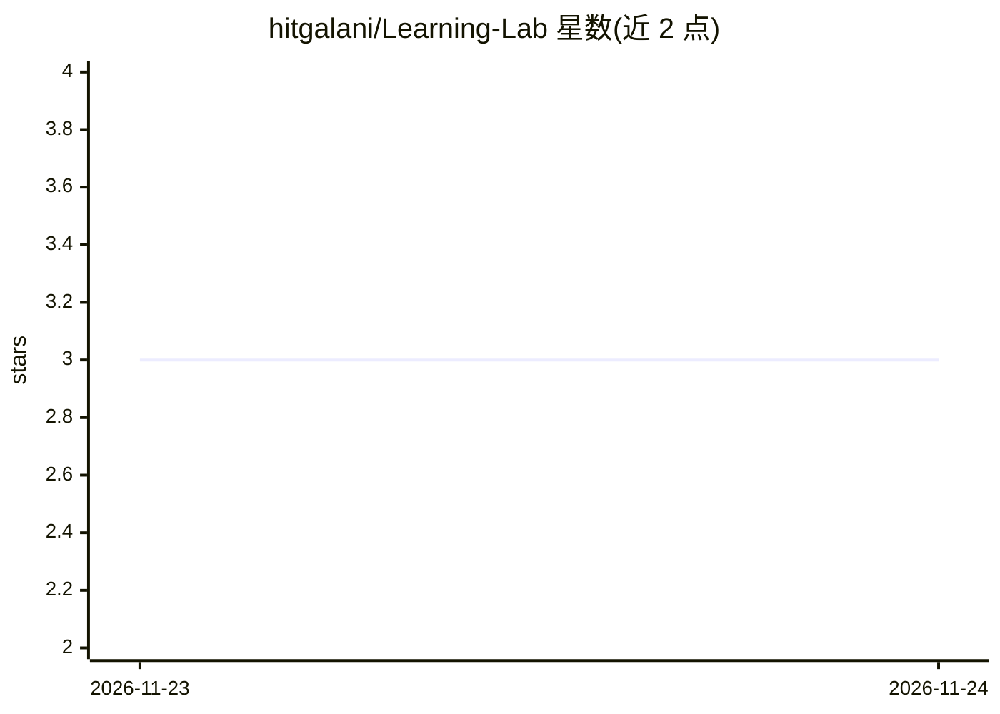

# hitgalani/Learning-Lab

⭐ 3 · Python · 推送 2026-11-17 · [GitHub](https://github.com/hitgalani/Learning-Lab) · 个人维护

**个人学习资源合集：AI、编程与开发的多来源资料整理**

作者个人收集的学习资料仓库，按来源（YouTube 频道、在线课程、大学课程材料、文档、自学笔记）与主题（编程语言、人工智能/机器学习/深度学习/数据科学、Web 开发等）组织。内容为课程、笔记、作业、练习代码与书籍文章等资料的集合，用途是集中管理个人学习资源并供他人浏览；仓库可 fork 用于练习并创建自己的项目，无安装或运行步骤。

## 筛选速览

| 维度 | 判定 | 备注 |
|---|---|---|
| AI 角色 | `ai-knowledge` | 知识聚合/清单类 |
| 许可风险 | `none` | — |
| 部署形态 | `None` |  |
| 模型依赖 | — | README 未给出锁定关系 |
| 硬件要求 | — | 无带数字的原话,不猜 |
| 安装摩擦 | `low` | 无编译、无系统依赖或容器化 |
| 成熟度 | — | 结构信号不足 |

## 能力要点

- 按来源类型（视频/课程/文档/笔记）与主题双重组织资料
- 覆盖编程语言、AI/ML/深度学习、数据科学与 Web 开发
- 可 fork 用于练习与创建自己的项目

## 适用场景

- 查找 AI 与机器学习方向的学习资料入口
- 参考他人整理的编程课程与文档清单
- fork 后作为自己学习资源的管理模板

## 场景标签

`精选清单` · 领域:学习与行业

## 证据(README 行号)

> L1: # Learning Resources 📚
> L5: This folder contains all the educational resources I collect and use to improve my knowledge and skills.
> L15: - **Artificial Intelligence:** AI, Machine Learning, Deep Learning, Data Science, and related topics.

## 星数曲线

2026-11-23 3 → 2026-11-24 3（+0）

---
*卡片 v1 · prompt 1.4 · 生成 2026-11-23 · 置信度 high · 依据 README sha `e1c7a30f9d01` · [字段定义](../../DATASET.md)*
